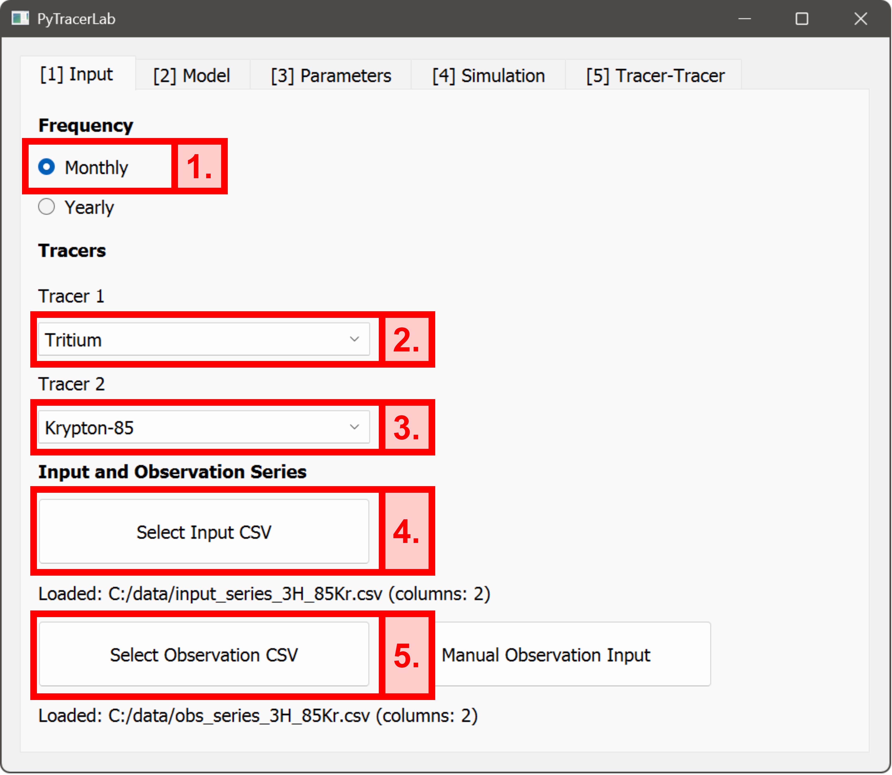
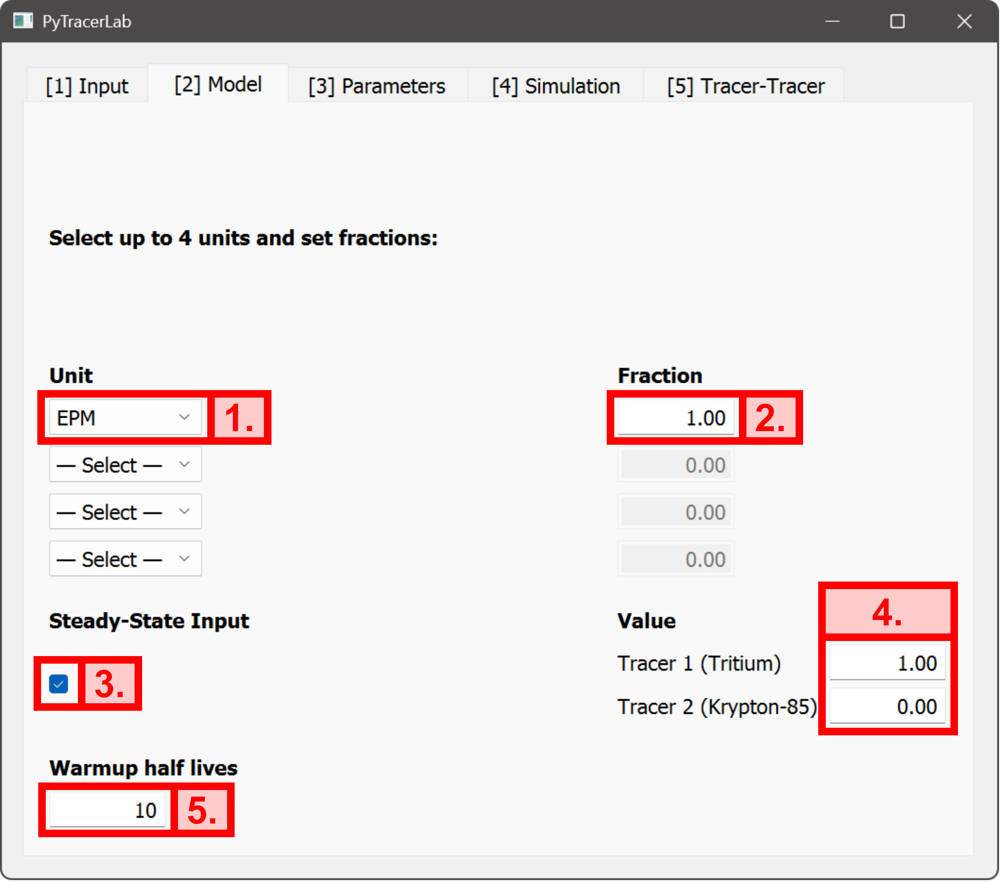
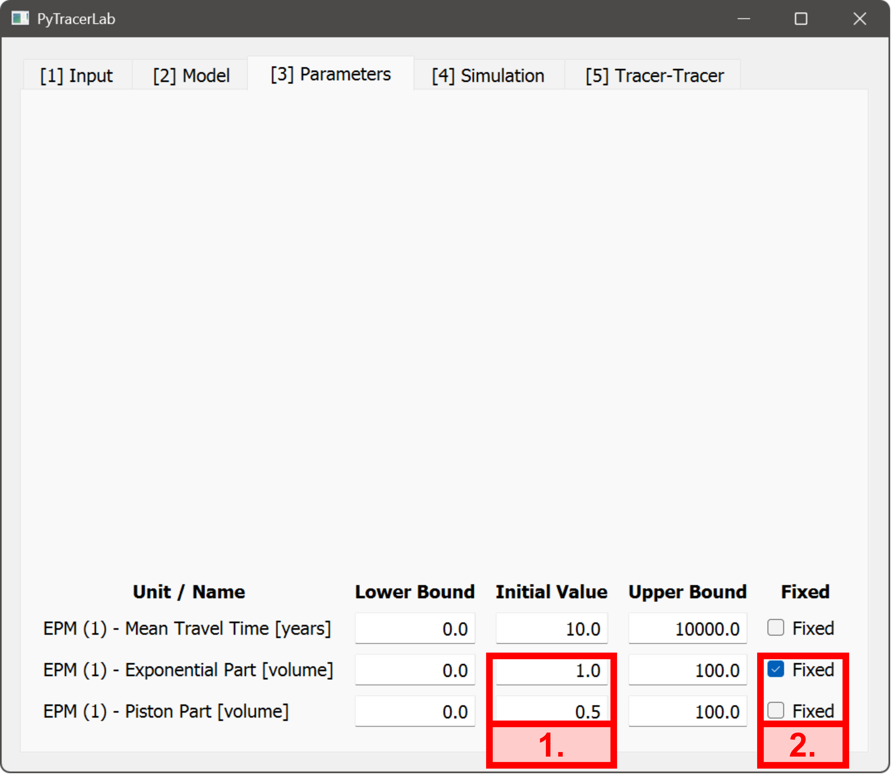
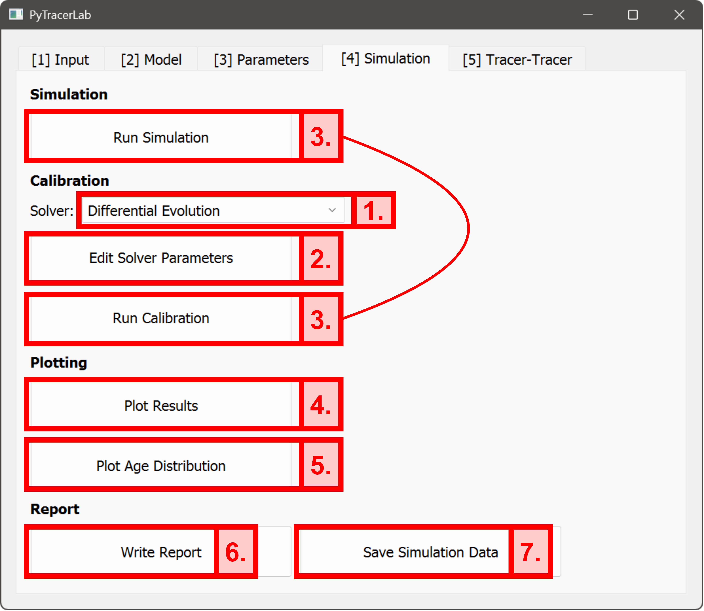
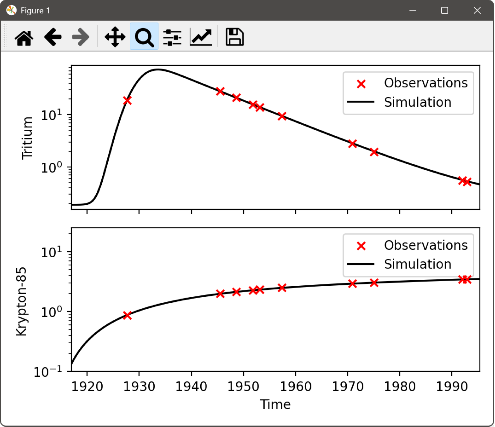
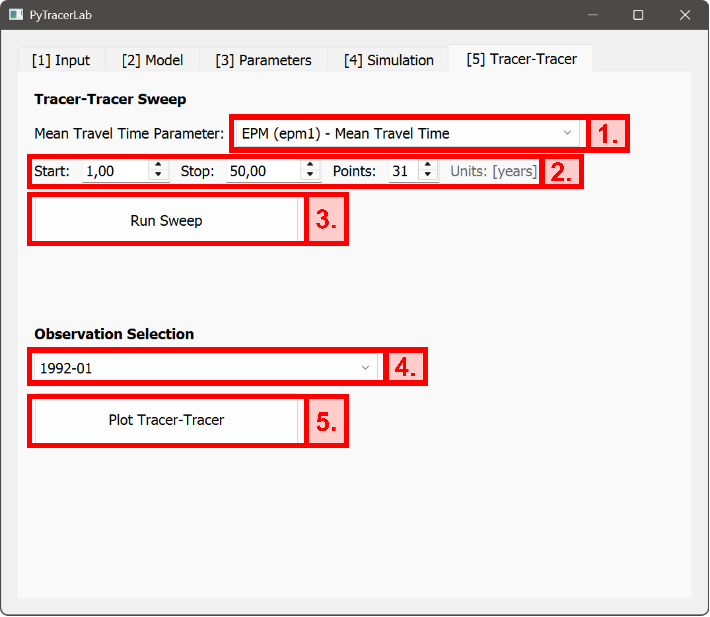
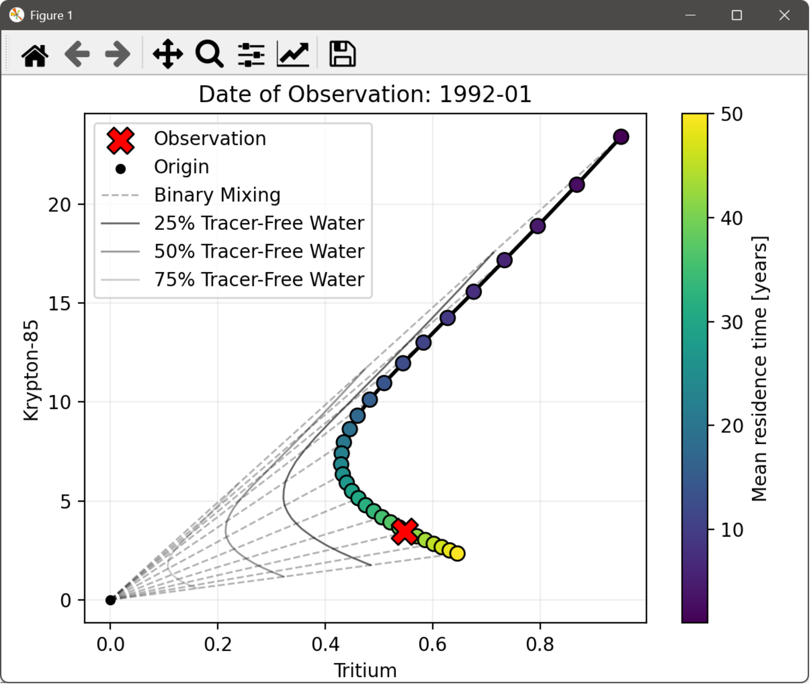

# Verwendung des GUI: ein detailliertes Beispiel

Dieses Beispiel demonstriert die Funktionalität des GUI (Graphical User Interface). Wir verwenden bereits vorhandene Daten von Tracer-Eingang und Beobachtungen, die synthetisch erzeugt wurden (siehe [Tutorial 5](../examples/example_05.ipynb)), aber genau dieselben Schritte lassen sich mit beliebigen eigenen Daten durchführen. Dieses Beispiel behandelt den Fall zweier Tracer (Tritium und Kr-85). Beobachtungen der Tracer-Konzentrationen im Grundwasser liegen für eine Reihe von Zeitpunkten vor, wobei jeweils beide Tracer-Konzentrationen gemessen wurden. Das GUI kann auch Fälle behandeln, in denen zu bestimmten Zeitpunkten nur einer der beiden Tracer beobachtet wurde. Weitere Informationen finden Sie im [Benutzerhandbuch](usage.md).

```{tip}
Ziehen Sie diese Anleitung zu Rate, wenn Sie auf Probleme mit des GUI stoßen. Der größte Teil der GUI-Funktionalität wird hier behandelt, wodurch die meisten aufkommenden Fragen beantwortet werden sollten.
```

## Daten laden
Wir verwenden Tritium- und Kr-85-Eingangsdaten (examples/example_input_series_2tracer.csv) und Ausgangsdaten (examples/example_observation_series_2tracer.csv) und nehmen die grundlegenden Modelleinstellungen im Eingabe-Tab vor:
1. Setzen Sie die Modellauflösung auf `Monthly`. Diese Einstellung bestimmt, wie die Eingangsdaten aussehen sollten und umgekehrt.
2. Wählen Sie `Tritium` als ersten Tracer; die zugehörigen Daten befinden sich in der **ersten Spalte** der Modelleingangs- und Beobachtungsdaten.
3. Wählen Sie `Krypton-85` als zweiten Tracer; die zugehörigen Daten befinden sich in der **zweiten Spalte** der Modelleingangs- und Beobachtungsdaten.
4. Wählen Sie die Eingangsdatei `example_input_series_2tracer.csv` über den Dateidialog, der sich beim Klick auf die Schaltfläche öffnet.
5. Wählen Sie die Beobachtungsdatei `example_observation_series_2tracer.csv` über den Dateidialog, der sich beim Klick auf die Schaltfläche öffnet.

```{tip}
Es ist auch möglich, Beobachtungsdaten manuell im GUI einzugeben. Wenn Sie diese Funktion nutzen möchten, geben Sie **keine** Beobachtungsdatei vorher an. Dies sollte dann Schritt 5 von zuvor ersetzen.
```



## Modellaufbau
In diesem Beispiel gibt es ein bekanntes, wahres Referenzmodell, das in der Praxis nicht verfügbar ist. Die in diesem Tab erstellte Modellstruktur sollte stets auf einem konzeptionellen Verständnis des untersuchten Grundwasserströmungssystems beruhen. Weitere Informationen finden Sie im [Benutzerhandbuch](usage.md). Im vorliegenden Beispiel richten wir die Modellstruktur so ein, dass sie der wahren Referenzmodellstruktur entspricht. Wir verwenden außerdem das korrekte Verhältnis von Kolbenströmungsvolumen und exponentiellem Strömungsvolumen. Auch dies wäre in der Praxis nicht möglich, und eine sorgfältige Modellkonzeptualisierung ist hier erforderlich. Wir erstellen die Modellstruktur in den folgenden Schritten:
1. Wählen Sie das EPM (Exponential Piston Flow Model) aus der Liste.
2. Geben Sie den Anteil an der Gesamtmodellausgabe ein, der durch diese Modelleinheit repräsentiert wird. Hier ist das EPM die einzige Modelleinheit, daher müssen wir hier einen Wert von `1.0` verwenden. Hätten wir mehrere Modelleinheiten parallel, könnten deren jeweilige Anteile unterschiedlich sein, sie müssen sich aber zu `1.0` summieren (z. B. `0.7` und `0.3` für zwei parallele Einheiten).
3. Aktivieren Sie den stationären Tracer-Eingang (steady-state).
4. Geben Sie die stationären Tracer-Eingangskonzentrationen ein (`1.0` für Tritium, `0.0` für Krypton-85). Sie werden für das gesamte Wasser verwendet, das älter als die Eingangszeitreihe ist (siehe [Benutzerhandbuch](usage_de.md)).

```{tip}
Die Verwendung mehrerer paralleler Modelleinheiten ermöglicht die Abbildung komplexerer Aquifer-Szenarien. Betrachten Sie zum Beispiel den Fall, in dem der beprobte Brunnen zwei durch eine Grundwassernichtleiterschicht getrennte Aquifere durchdringt. Das Brunnenwasser ist dann eine Mischung verschiedener Wässer mit unterschiedlichen Grundwasserströmungs- und Verweilzeiteigenschaften. Die Verwendung von z. B. zwei parallelen Einheiten ermöglicht eine detailliertere Abbildung solcher Fälle.
```



## Modellparameter festlegen
Die im entsprechenden Tab eingegebenen Parametereinstellungen werden an verschiedenen Stellen der Software verwendet. Der `Initial Value` wird stets für reguläre Simulationen verwendet, die mit `Run Simulation` ausgelöst werden, und dient außerdem als Startwert für die Modellkalibrierung. Untere und obere Grenzen der Parameter werden ebenfalls während der Kalibrierung verwendet. Parameter, die jederzeit auf ihren Startwerten bleiben sollen, können konstant gehalten werden, indem das `Fixed`-Kästchen des entsprechenden Parameters aktiviert wird. Im vorliegenden Beispiel führen wir in diesem Tab die folgenden Schritte durch:
1. Geben Sie ein Volumen von `1.0` für den exponentiellen Teil des Modells und ein Volumen von `0.5` für den Kolbenströmungsteil des Modells ein.
2. Stellen Sie sicher, dass der Wert entweder des exponentiellen Teils oder des Kolbenströmungsteils fixiert ist (nicht beide fixiert und nicht beide unfixiert).

```{warning}
Wenn das Exponential Piston Flow Model (EPM) als Modelleinheit ausgewählt ist, werden die Parameter, die die jeweiligen Anteile von exponentiellem und Kolbenströmungsteil steuern, beide als fixierte Parameter initialisiert. Dies liegt daran, dass es nicht möglich ist, beide Parameter gleichzeitig zu kalibrieren, da dasselbe Verhältnis von exponentiellem und Kolbenströmungsteil mit unendlich vielen Werten erreicht werden kann (d. h. 1/2 = 2/4 = 4/8 = ... = 0.5).
```



## Eine Simulation durchführen und / oder Modellparameter kalibrieren
In den meisten Anwendungen ist es notwendig, entweder einfache Simulationen (oder Vorwärtsläufe) mit definierten Parameterwerten durchzuführen oder Modellparameter auf Grundlage verfügbarer Beobachtungsdaten zu kalibrieren. In beiden Fällen ist es typischerweise erforderlich, Modellergebnisse zu plotten, die Verweilzeitverteilung zu plotten sowie Ergebnisse und simulierte Daten zu exportieren. Im vorliegenden Fall wird die Modellkalibrierung mit einem `Differential Evolution`-Optimierungsansatz durchgeführt. Im vorliegenden Beispiel führen wir die folgenden Schritte durch:
1. Wählen Sie `Differential Evolution` als Solver.
2. Bearbeiten Sie gegebenenfalls die Solver-Parameter (in diesem Beispiel werden die Parameter nicht geändert, würden aber bei Bedarf an dieser Stelle geändert).
3. Führen Sie die Modellkalibrierung aus. Wenn eine einfache Simulation (Vorwärtslauf) durchgeführt werden soll, können die ersten beiden Schritte übersprungen und eine Simulation als erster Schritt ausgeführt werden.
4. Plotten Sie die Ergebnisse.
5. Plotten Sie die Verweilzeitverteilung.
6. Erstellen Sie den Modellbericht (speichern Sie die Datei über den Dateidialog an einem bestimmten Ort).
7. Speichern Sie die Simulationsdaten (speichern Sie die Datei über den Dateidialog an einem bestimmten Ort).

```{tip}
In PyTracerLab stehen verschiedene Kalibrierungsansätze zur Verfügung. Alle diese Ansätze lassen sich in ihrem Verhalten über `Edit Solver Parameters` weiter steuern.
```

```{warning}
Solver-Parameter sind grundsätzlich auf robuste Standardwerte gesetzt. Sie sollten nur geändert werden, wenn Sie wissen, was Sie tun. Prüfen Sie die API-Dokumentation für weitere Informationen und ziehen Sie auch die vorhandene Literatur dazu heran, wie die verschiedenen Ansätze funktionieren (least squares, differential evolution, Metropolis-Hastings MCMC, DREAM MCMC).
```





## Tracer-Tracer-Analyse durchführen
Um Analysen mit mehreren Tracern durchzuführen, kann der `Tracer-Tracer`-Tab des GUI verwendet werden. Derzeit ist das GUI auf die Analyse von höchstens 2 Tracern parallel beschränkt; diese Beschränkung besteht beim Python-Paket nicht. Nachdem eine Modellstruktur festgelegt wurde (die potenziell mehrere Modelleinheiten umfasst), führt die Tracer-Tracer-Analyse eine Reihe von Modellsimulationen mit unterschiedlichen Werten **eines** mittleren Verweilzeit-Parameters durch – werden mehr als eine Modelleinheit verwendet, muss ein mittlerer Verweilzeit-Parameter angegeben werden, der während der Analyse verändert wird. Im vorliegenden Beispiel wird nur eine Modelleinheit betrachtet, und im Modell existiert nur ein mittlerer Verweilzeit-Parameter. Für die verschiedenen Werte des mittleren Verweilzeit-Parameters (die typischerweise einen bestimmten Bereich abdecken, z. B. 1 bis 50 Jahre) wird das Modell dann simuliert und die resultierende Zeitreihe der simulierten Konzentrationen gespeichert. Im letzten Schritt der Analyse ist es möglich, einen verfügbaren Beobachtungszeitpunkt (aus allen verfügbaren Zeitpunkten, denen ein beobachteter Wert zugeordnet ist) auszuwählen, für den ein Tracer-Tracer-Plot erzeugt werden kann. In diesem Beispiel führen wir die folgenden Schritte durch:
1. Wählen Sie den `Mean Travel Time Parameter`, der während der Analyse verändert werden soll, aus der Liste.
2. Legen Sie den Startpunkt und den Endpunkt für die Analyse sowie die Gesamtzahl der während der Analyse zu verwendenden mittleren Verweilzeit-Parameter fest. Dies definiert den „Sweep-Bereich“.
3. Führen Sie den „Sweep“ der verschiedenen mittleren Verweilzeit-Parameter aus.
4. Wählen Sie einen Beobachtungszeitpunkt aus der Liste der verfügbaren Beobachtungszeitpunkte.
5. Erzeugen Sie den Tracer-Tracer-Plot für diesen Beobachtungszeitpunkt.




