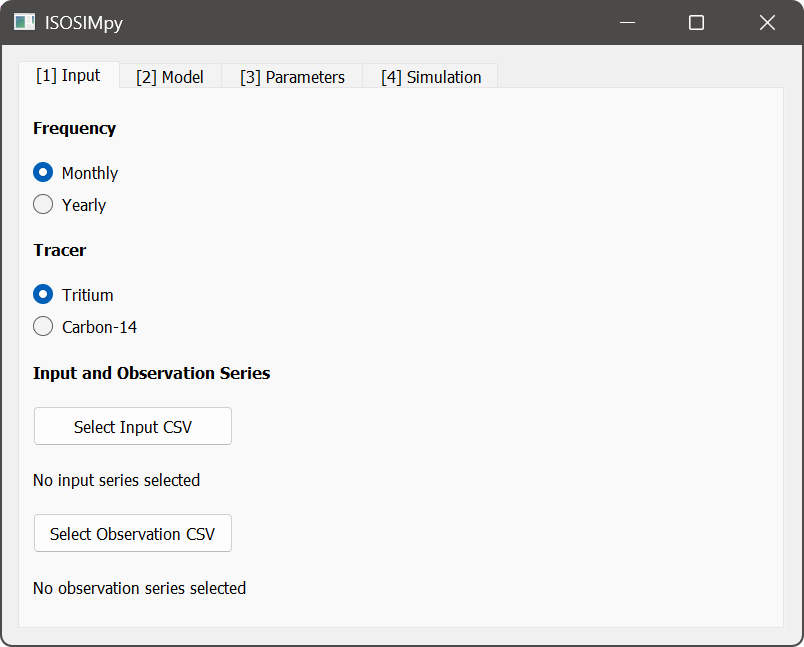
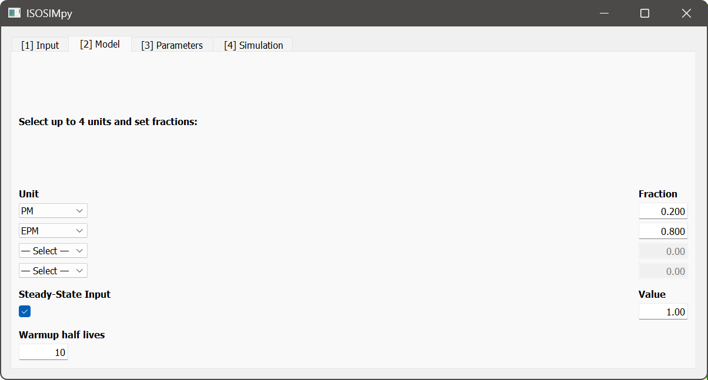
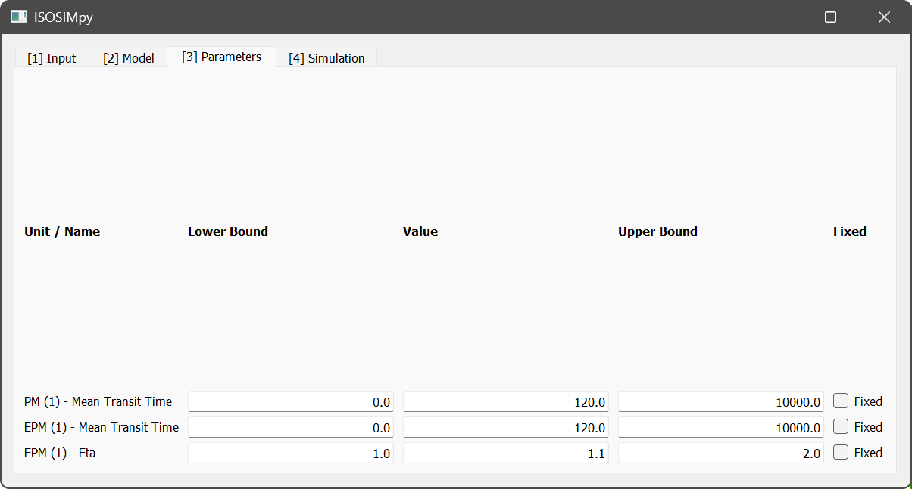
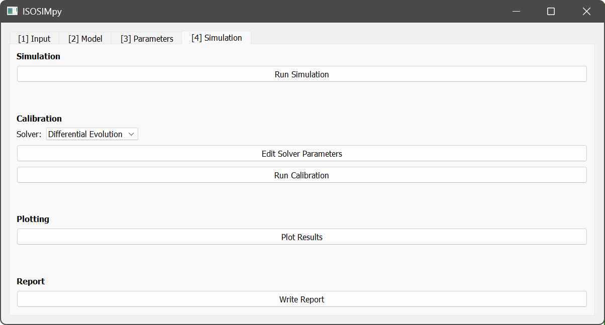
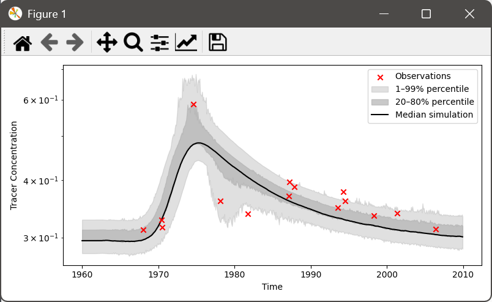
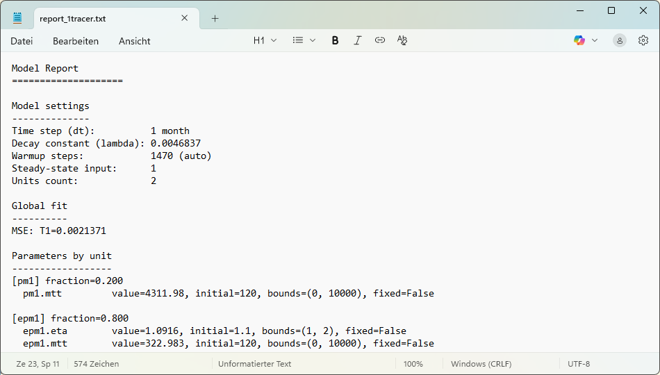

# Using PyTracerLab

(get-running)=
## Get PyTracerLab Running on Your Machine

This section is written for readers who have never used GitHub before and simply want the program on
their computer. It describes **every single click** from the PyTracerLab project page to an open
PyTracerLab window. No programming knowledge, no Python installation and no GitHub account are
required.

**Before you start, you need:**

- a PC running **Windows 10 or Windows 11**
- an internet connection
- about **500 MB of free disk space** (the program file itself is about 91 MB, and it unpacks itself
  temporarily every time it runs)
- roughly **5 minutes**

You do **not** need administrator rights, and nothing is written into your Windows system folders.

```{note}
**This route is for Windows only.** If you use macOS or Linux, or if your computer is managed by an
IT department that blocks programs from unknown publishers, follow
[Running PyTracerLab Locally](local_installation.md) instead. That guide installs PyTracerLab as a
Python program and works on every operating system.
```

### Step 1 — Open the PyTracerLab page on GitHub

Open your web browser and go to:

<https://github.com/iGW-TU-Dresden/PyTracerLab>

GitHub is the website where the PyTracerLab source code and the ready-to-use program are stored. The
page you land on is called the *repository*. You do **not** need a GitHub account, and you do **not**
need to sign in — everything in this guide works without an account.

The middle of the page shows a list of folders and files (`docs`, `src/PyTracerLab`, `LICENSE`, and
so on). **You can ignore all of it.** The part you need is on the right-hand side of the page.

### Step 2 — Find the "Releases" box on the right

Look at the **right-hand column** of the page. From top to bottom it contains a section called
**About** (with a short description of the project), and below it a section headed **Releases**. It
is outlined in red in the picture below.


A *release* is a finished, packaged version of the program. The **Releases** box shows the newest
one, marked with a green **Latest** label — at the time of writing that is **v0.2.9**. The version
number you see will probably be higher, which is correct and expected.


```{tip}
**Cannot see the Releases box?** If your browser window is narrow, GitHub moves the entire right-hand
column to the **very bottom** of the page. Either scroll all the way down, or make the browser window
wider (or press the maximise button in the top-right corner of the window).
```

### Step 3 — Open the list of releases

Inside the **Releases** box, click on the version number itself (for example **v0.2.9**), or on the
blue **+ 19 releases** link just below it. Either one takes you to the same place: the page listing
all released versions.

### Step 4 — Find the download files ("Assets")

The page you are now on lists every released version, **newest first**. The newest version is at the
top and carries the green **Latest** label.

Underneath that newest version, find the heading **Assets** with a small number next to it. "Assets"
is GitHub's word for *the files you can download for this version*. The list is usually already open.
If instead you only see a small triangle **▸ Assets**, click on the word **Assets** once to unfold
the list.


### Step 5 — Download the right file

The **Assets** list contains five entries. Only **one** of them is the program:

| File in the list | What it is | Do you need it? |
| --- | --- | --- |
| `pytracerlab-0.2.9-py3-none-any.whl` | Python package | No |
| `pytracerlab-0.2.9.tar.gz` | Python source package | No |
| **`PyTracerLab-v0.2.9.exe`** | **The ready-to-use program** | **Yes — this one** |
| `Source code (zip)` | The source code | No |
| `Source code (tar.gz)` | The source code | No |

**Click on the file whose name ends in `.exe`** — it is outlined in red in the picture above. The
number in the name is the version and will be higher than `0.2.9` in newer releases; always take the
`.exe` file, whatever its version number.

The file is about **91 MB**, so the download takes a moment. Your browser will show the progress.

### Step 6 — Confirm your browser's download warning

Your browser will very likely warn you about this file, with wording such as *"This file isn't
commonly downloaded"* or *"…was blocked because it could harm your device"*.

This warning appears because the file is not digitally signed with a paid code-signing certificate.
PyTracerLab is free academic software and does not have one. The warning says nothing about the
contents of the file — it appears for every downloaded program without such a certificate.

To keep the file:

- **Google Chrome** — the download appears in a small panel at the top right of the browser. Move the
  mouse over the entry, click the **⋮** (three dots) next to it, and choose **Keep**.
- **Microsoft Edge** — same place, top right. Click the **⋯** (three dots) next to the blocked
  download, choose **Keep**, then **Show more** → **Keep anyway**.
- **Mozilla Firefox** — click the downloads arrow in the toolbar, right-click the entry and choose
  **Allow download**.

### Step 7 — Find the downloaded file on your computer

The file is now in your **Downloads** folder, normally:

```
C:\Users\<your Windows user name>\Downloads
```

To get there, open the **File Explorer** (the yellow folder icon in the taskbar, or press
`Windows + E`) and click **Downloads** in the left-hand column. You are looking for the file
**`PyTracerLab-v0.2.9.exe`**.

```{important}
**This single file *is* the whole program.** There is nothing to install. There will be no entry in
the Start menu and no icon on the desktop. You can move the file anywhere you like — for example onto
your Desktop or into a folder of your choice — and start it from there. If you delete the file, the
program is gone from your computer.
```

### Step 8 — Start the program and get past the Windows warning

**Double-click** the file `PyTracerLab-v0.2.9.exe`.

Windows will most likely show a blue window titled **"Windows protected your PC"** (in German:
*"Der Computer wurde durch Windows geschützt"*). At first this window appears to offer only a single
button, **Don't run** (*"Nicht ausführen"*).

Do the following:

1. Click the small link **More info** (*"Weitere Informationen"*), directly under the message text.
2. The window expands and now shows the file name, the publisher — and a new button
   **Run anyway** (*"Trotzdem ausführen"*) at the bottom right.
3. Click **Run anyway**.

This warning has the same cause as the download warning in Step 6: the program is not signed with a
paid certificate. You only have to confirm it the first time for each downloaded file.

```{tip}
You can also remove the warning beforehand: right-click the file, choose **Properties**, and at the
bottom of the **General** tab tick the **Unblock** checkbox, then click **OK**.
```

### Step 9 — Wait for the first start

```{warning}
**Nothing will seem to happen for 10 to 40 seconds.** This is normal.
```

The program is packed into a single file and has to unpack itself into a temporary folder before the
window can appear. On the first start this takes noticeably longer than later on. There is no
progress bar and no splash screen while this happens.

**Do not double-click the file again during this time** — that simply starts a second copy of the
program. Wait until the window appears. Later starts are considerably faster.

### Step 10 — The program is running

The PyTracerLab main window opens on the **Input** tab and looks like this:



That's it — PyTracerLab is running. Continue with [The Input Tab](#input-tab) below, which explains
what to do next. If you would like to be guided through a complete analysis from beginning to end,
see [Using the GUI: a Detailed Example](detailed_example.md).

### Starting PyTracerLab again later

There is nothing else to install. Whenever you want to use PyTracerLab again, simply double-click the
same `.exe` file. The Windows warning from Step 8 will not appear again for this file.

### Updating to a newer version

PyTracerLab does **not** update itself. To move to a newer version, repeat Steps 1 to 8 — you will
get a `.exe` file with a higher version number. You can then delete the old file.

### If something went wrong

**I double-clicked the file and nothing happens.**
Wait a full minute — see Step 9. If there is still no window, open the Windows **Task Manager**
(`Ctrl + Shift + Esc`) and check whether `PyTracerLab` is listed under *Processes*. If several copies
are listed, end them all and try once more with a single double-click.

**The "Windows protected your PC" window has no "Run anyway" button.**
The button only becomes visible after you click **More info** — see Step 8. If your employer's IT
policy blocks unsigned programs entirely, the button may be missing altogether. In that case use
[Running PyTracerLab Locally](local_installation.md) instead.

**The file disappeared after downloading it.**
Your antivirus software quarantined it. Programs packed in this way are a frequent source of false
alarms. Restore the file from your antivirus program's quarantine list, or use
[Running PyTracerLab Locally](local_installation.md).

**The window appears briefly and then closes immediately.**
This route deliberately starts the program without a console window, so any error message is
invisible. To see what went wrong, install PyTracerLab as a Python program following
[Running PyTracerLab Locally](local_installation.md) and start it with the `PyTracerLab` command —
that variant keeps a console window open in which the error message is shown. Please report the
message via [GitHub Issues](https://github.com/iGW-TU-Dresden/PyTracerLab/issues).

**I am not using Windows.**
The `.exe` file only runs on Windows. Follow [Running PyTracerLab Locally](local_installation.md),
which works on macOS and Linux as well.

## Using the Graphical User Interface
In general, using the Graphical User Interface (GUI) is stricter and less versatile than using the package it is built on. Specifically, the app assumes a certain structure of time series data, is not scalable well to handle many different datasets, and offers limited post-processing functionality. Nevertheless, the GUI is a highly user-friendly option to performing analysis of groundwater travel time distributions using lumped parameter models.

```{important}
Input and observation data are read from text files (e.g. CSV) with one row per date: the first column holds the date, every further column one tracer, with the column names in a header line. Tracer input time series need regular monthly or yearly time steps without gaps; observations can be listed only at their sampling dates. See [Preparing Datasets](#preparing-datasets) for a detailed description of the file structure and for [templates](#data-templates).
```

(example-datasets)=
### Example Files
The following example files can be downloaded and loaded directly into the GUI. They cover different use cases regarding temporal resolution and the number of tracers. When loading a file, select the temporal resolution and the tracer(s) that match the file on the Input Tab.

| Input file | Observation file | Resolution | Tracers | Period | Notes |
| --- | --- | --- | --- | --- | --- |
| {download}`example_input_series_1tracer.csv <../examples/example_input_series_1tracer.csv>` | {download}`example_observation_series_1tracer.csv <../examples/example_observation_series_1tracer.csv>` | monthly | 1 | 1960-01 – 2009-12 | |
| {download}`example_input_series_2tracer.csv <../examples/example_input_series_2tracer.csv>` | {download}`example_observation_series_2tracer.csv <../examples/example_observation_series_2tracer.csv>` | monthly | 2 (Tritium, Krypton-85) | 1900-01 – 1999-12 | used in the [detailed example](detailed_example.md) |
| {download}`TracerLPM_benchmark_input_yearly.csv <../examples/TracerLPM_benchmark_input_yearly.csv>` | {download}`TracerLPM_benchmark_observations_yearly.csv <../examples/TracerLPM_benchmark_observations_yearly.csv>` | yearly | 1 | 1850 – 2020 | TracerLPM benchmark |
| {download}`3H_SF6_input.csv <../examples/3H_SF6_input.csv>` | {download}`3H_SF6_observations.csv <../examples/3H_SF6_observations.csv>` | yearly | 2 (Tritium, SF6) | 1900 – 2020 | SF6 is not in the GUI tracer list; select *Stable tracer (no decay)* for it |
| {download}`input_monthly_modflow.csv <../examples/input_monthly_modflow.csv>` | – | monthly | 1 | 1970-01 – 2019-12 | no observation file; enter observations via *Manual Observation Input* |
| {download}`benchmark_input_monthly.csv <../examples/benchmark_input_monthly.csv>` | – | monthly | 1 | 1960-01 – 1969-12 | pulse input for inspecting the model response |
| {download}`benchmark_input_yearly.csv <../examples/benchmark_input_yearly.csv>` | – | yearly | 1 | 1960 – 1969 | pulse input for inspecting the model response |

### Structure of the GUI
The GUI is structured into different **Tabs**. Those **Tabs** represent the typical workflow and should be considered in their present order. The individual **Tabs** are described in more detail below.

```{warning}
PyTracerLab is still under active development. While the general functionality is well-tested, the GUI still poses some issues that we're actively working on.
```

```{warning}
PyTracerLab does not support any pre-processing steps of input data at the moment. Precipitation weighting, gas exchange, etc. have to be performed by the user beforehand.
```

```{tip}
To avoid issues when using the GUI, please perform all steps on all tabs in the order they are shown on the tab. For example, on the input tab, first specify the temporal resolution, then specify the tracer(s), then load corresponding input data, then load corresponding observation data.
```

(input-tab)=
### 1. The Input Tab
In this **Tab**, datasets are loaded and the most basic settings for subsequent modelling are made.
- select temporal resolution (yearly or monthly data in time series and model simulations)
- select one or two tracers to be considered in the analysis (e.g. $^3\mathrm{H}$, $^{14}\mathrm{C}$, $^{85}\mathrm{Kr}$); one tracer per column of the data files, in the same order
- select and load the tracer input time series file using the file dialog that opens up; its time step must match the selected temporal resolution; see [here](#preparing-datasets) for details on how to prepare tracer input time series files
- select and load the observation file using the file dialog that opens up (after the input series); observations can be listed for every time step of the input series or only at the sampling dates; see [here](#preparing-datasets) for details on how to prepare observation files
- if a file cannot be read, a message names the line and the value that caused the problem

```{important}
The same units of tracer concentration should be used in both the tracer input data and the observation data. Units are not checked internally. **If units are not equal, unwanted and wrong results are obtained!**
```


### 2. The Model Tab
```{warning}
Lumped parameter model structure should always be based on a conceptual understanding of the groundwater flow system under study. There is a lot of literature on this topic. If you have never heard of things like "Exponential Model", "Binary Mixing Model", or "Convolution Integral", you should read up on those topics before continuing. Lumped parameter models are easy to use but hard to master - corresponding modelling results should always be carefully interpreted before drawing any conclusion.
```
In this **Tab**, the different model parts are selected that are included in the simulations.
- select up to 4 model units to be used in parallel
    - available units:
        - Piston-Flow Model (**PM**)
        - Exponential Model (**EM**)
        - Exponential Piston-Flow Model (**EPM**)
        - Dispersion Model (**DM**)
    - each unit is associated with a corresponding fraction of the total system response or output; the fractions are between 0 and 1 and must sum to one, otherwise an error is raised, and the model will not run
    - with exactly two units (binary mixture), only the fraction of the first unit is entered; the fraction of the second unit is calculated as 1 minus this value. The fraction of the first unit can be calibrated (see [Mixing Fractions](#mixing-fractions))
- specify if there is a steady state tracer input that should be considered for the time prior to the start of the datasets
- specify the warmup time span
    - this prepends the steady state tracer input for the time of the number of tracer half lives specified here
    - model warmup helps to remove unwanted irregularities that can appear in early phases of simulations; see [here](#model-warmup) for more details
    - in the case of two tracers, **the longer of the two half lives is used**

```{important}
The steady state input value is interpreted in the same units that are used in the tracer input and observation datasets. Units are not checked internally. **If units are not equal, unwanted and wrong results are obtained!**
```



### 3. The Parameters Tab
In this **Tab**, settings are made regarding model parameters, how they are bounded during calibration, and what current values they take.
- specify the lower bound, current value, upper bound, and calibration status for all model parameters; different model parameters are organized in rows
    - the value that is specified for a parameter will be used as its value for simple simulation and as the initial value for calibration
    - parameters that are set to *fixed* remain at their specified value during calibration
- with two units, an additional row *mixing fraction* holds the fraction of the first unit: its value is set in the Model Tab, its bounds and calibration status here; it is *fixed* by default (see [Mixing Fractions](#mixing-fractions))
    - a note is shown if the mixing fraction and the mean travel times of both units are free, because these parameters are often strongly correlated

```{important}
Parameter time units are always in years. Half lives are internally converted but other parameters having time units are interpreted in months.
```



(simulation-tab)=
### 4. The Simulation Tab
In this **Tab**, simulations can be performed, model parameters can be calibrated automatically, results can be plotted, and reports can be generated.
- perform a model simulation using the current parameters
- perform model calibration
    - select a solver
    - change solver parameters (requires at lease a basic understanding of the solvers)
    - set the measurement uncertainty of the observations (applies to all solvers; see [Measurement Uncertainty](#measurement-uncertainty)); the current setting is shown below the button *Edit Solver Parameters*
    - run automatic calibration
- plot results of current simulation / calibrated model simulation
- write a report including the calibrated parameters, error metrics, and other model details to a text file; uses a file dialog to store the report file

```{tip}
All plots that PyTracerLab generates can be interactively adapted in the plot-view. See the (matplotlib documentation)[https://matplotlib.org/stable/users/explain/figure/interactive.html] for more details on how to change plot appearance.
```







(preparing-datasets)=
## Preparing Datasets
PyTracerLab reads tracer input time series and observations from plain text files, for example CSV files exported from a spreadsheet program. The GUI and the Python package use the same reader (the function `read_series`), so the rules below apply to both.

(data-templates)=
### Templates
The easiest way to start is to download the templates and replace the example values with your own data:

- {download}`input_template.csv <../examples/templates/input_template.csv>` – tracer input time series (yearly, one tracer)
- {download}`observations_template.csv <../examples/templates/observations_template.csv>` – observations at the sampling dates, with measurement uncertainties

The [Example Files](#example-datasets) are complete datasets in the same format.

```{note}
PyTracerLab contains the properties of the supported tracers (e.g. half-lives) but no tracer input records. Tracer input time series can be obtained from public sources, for example the Global Network of Isotopes in Precipitation (GNIP) of the IAEA and WMO for tritium (<https://nucleus.iaea.org/wiser>). Any processing of the input data (e.g. precipitation weighting, unit conversion) has to be done before the data are loaded into PyTracerLab.
```

### File Structure
- **One row per date.** The first column holds the date, every further column one tracer.
- **Header line:** a line with the column names directly above the first data row is optional but recommended, e.g. `Date, 3H, SF6`. It may start with `#`. Lines starting with `#` above the header line are comments.
- **Delimiter:** comma, semicolon, tab or spaces; detected automatically. Files with semicolon, tab or space delimiters may use a decimal comma (`10,5`).
- **Dates:** `YYYY`, `YYYY-MM`, `YYYY-MM-DD` (also with `/`), `DD.MM.YYYY`, `MM.YYYY` or a decimal year (e.g. `1985.5`). A time of day after the date is ignored, and a year alone refers to 1 January of that year.
- **Missing values:** empty cell, `nan`, `NA`, `n/a` or `-`.
- **Measurement uncertainty (optional):** a column named `<tracer>_sd` (e.g. `3H_sd`) holds the measurement uncertainty of the column `<tracer>` as a standard deviation, in the same unit as the tracer. It is used to weight the observations in the calibration (see [Measurement Uncertainty](#measurement-uncertainty)).
- **Units:** the same unit has to be used for a tracer in the input file and in the observation file. Units are not checked.
- **Number of values:** there is no fixed limit on the number of rows or observations.

### Tracer Input Time Series
Tracer input time series must have **regular time steps without gaps**. The GUI supports monthly and yearly time steps; select the matching option under *Frequency* on the [Input Tab](#input-tab) before loading the file. The Python package accepts any regular time step (e.g. half-yearly or daily). Irregular series (e.g. individual precipitation samples) have to be resampled first, for example to monthly or yearly values.

A yearly input file for two tracers:

```
Date, 3H, SF6
1950, 5.0, 0.0
1951, 5.2, 0.0
...
2020, 5.5, 10.1
```

The same with monthly time steps, semicolons and decimal commas:

```
Date; 3H; SF6
1950-01; 5,0; 0,0
1950-02; 5,1; 0,0
...
2020-12; 5,5; 10,1
```

### Observations
Observations are always related to the time steps of the tracer input time series. They can be given in two ways:

1. **Only at the sampling dates (recommended).** Each sample is assigned to the time step of the input series that contains its date; for example, a sample taken on 2009-09-30 is assigned to the time step 2009 of a yearly input series and to 2009-09 of a monthly one. Two samples of the same tracer in one time step are not allowed – please combine them into one value (e.g. their mean). All sampling dates must lie within the period of the input series.

   ```
   Date, 3H, 3H_sd, SF6, SF6_sd
   1985-06-12, 52.1, 1.6, ,
   1994-08-03, 18.3, 0.6, 2.4, 0.2
   2004-05-12, 8.9, 0.3, 4.1, 0.3
   ```

2. **For every time step of the input series.** The file has the same dates as the input file, with a missing value (e.g. `nan`) where nothing was observed. This is the format of the [Example Files](#example-datasets).

   ```
   # Date, 3H, SF6
   1950, nan, nan
   1951, nan, nan
   ...
   1985, 52.1, nan
   ...
   2020, nan, nan
   ```

The observation file must contain the same tracers in the same order as the input file; cells of tracers that were not measured in a sample are left empty. In the GUI, load the input series before the observations. If a file cannot be read, PyTracerLab names the line and the value that caused the problem.

### Loading Data in Python
In the Python package, the same files are loaded with `read_series`. With `align_to`, the observations are assigned to the time steps of the input series as described above:

```python
import PyTracerLab as lab

inp = lab.read_series("input_template.csv")
obs = lab.read_series("observations_template.csv", align_to=inp)
print(inp.tracers, inp.step)  # ['3H'] 1 year

model = lab.Model(
    dt=1.0,  # one time step = one year
    lambda_=lab.decay_constant("3H"),  # decay constant in 1/year
    input_series=inp.values,
    target_series=obs.values,
)
```

The result of `read_series` contains the dates (`times`), the values (`values`), the tracer names from the header line (`tracers`), the measurement uncertainties from the `_sd` columns (`uncertainty`) and the time step (`step`). See the {py:func}`API documentation <PyTracerLab.model.io.read_series>` for details.

(measurement-uncertainty)=
## Measurement Uncertainty
The measurement uncertainty of the observations determines how strongly each observation is weighted in the calibration: each residual (simulated minus observed value) is divided by the standard deviation σ of the observation. This matters in particular for tracers whose values span orders of magnitude, such as tritium. With a single σ for all observations, the observations with the largest values (and the largest absolute deviations) dominate the calibration.

The measurement uncertainty can be given in three ways:

- **per observation**, in the `_sd` columns of the observation file (see [File Structure](#preparing-datasets));
- **absolute**, as one standard deviation per tracer, in the unit of the tracer;
- **relative**, as a percentage of the observed value (e.g. 5 %).

Values from the observation file are used where they are given; the absolute or relative uncertainty applies to all other observations. If an observation is left without an uncertainty, PyTracerLab reports this instead of ignoring the observation.

The solvers use the uncertainty as follows:

- **Differential evolution and least squares** minimise the squared residuals divided by σ. Without an uncertainty, all observations are weighted equally.
- **MCMC and DREAM** use a Gaussian likelihood with the given standard deviations, which are treated as known. Without an uncertainty, the standard deviation of each tracer is treated as unknown and integrated out of the likelihood, i.e. it is effectively estimated from the misfit between simulation and observations.

```{note}
The parameter uncertainty obtained with MCMC or DREAM is conditional on the chosen model structure and on the specified measurement uncertainty. If σ describes only the analytical uncertainty while the model cannot reproduce the observations within this uncertainty, the posterior distribution can be too narrow.
```

**In the GUI**, the measurement uncertainty is set in the [Simulation Tab](#simulation-tab) under *Edit Solver Parameters* → *Measurement uncertainty (all solvers)* and applies to all solvers. The current setting is shown below the button *Edit Solver Parameters*. If uncertainties are specified, the plot of the results shows the observations with error bars (± 1 σ).

**In Python**, all solver methods accept `sigma` (absolute standard deviation: one value, one value per tracer, or one value per observation) and `sigma_rel` (relative standard deviation as a fraction of the observed value):

```python
solver = lab.Solver(model)

# uncertainties from the _sd columns of the observation file
result = solver.dream_sample(n_samples=2000, sigma=obs.uncertainty)

# 5 % of the observed value
result = solver.dream_sample(n_samples=2000, sigma_rel=0.05)

# from the file where given, 5 % of the observed value otherwise
result = solver.dream_sample(n_samples=2000, sigma=obs.uncertainty, sigma_rel=0.05)

# one absolute value per tracer (here: two tracers)
best, sim = solver.differential_evolution(sigma=[1.0, 0.5])
```

Other uncertainty models can be computed and passed as `sigma`, for example an absolute uncertainty of 0.3 TU combined with 5 % of the observed value: `sigma=np.sqrt(0.3**2 + (0.05 * obs.values) ** 2)`. See the {py:class}`API documentation <PyTracerLab.model.solver.Solver>` for details.

(mixing-fractions)=
## Mixing Fractions
In a binary mixture (two units in parallel), the fraction of the first unit, $f$, can be calibrated together with the other parameters; the second unit contributes $1 - f$. Like every other parameter, the fraction has bounds (between 0 and 1) and is *fixed* by default, so that it is only calibrated if this is explicitly requested. With three or four units, the fractions are fixed model properties; different fractions can then be compared in scenarios.

Whether the mixing fraction and the mean travel times of both units can be determined together depends on the available information:

- the number of independent observations must not be smaller than the number of free parameters. For a single sample, this means at least as many tracers as free parameters; PyTracerLab warns if there are more free parameters than observations;
- the tracers must carry complementary information. Tracers with contrasting input histories (e.g. tritium and SF₆) constrain a binary mixture much better than tracers with similar histories (e.g. tritium and tritiogenic helium); a long time series of observations also contains more information than a single sample;
- if the information is limited, fix the mean travel time of one unit (e.g. an "old", tracer-free component) and calibrate the fraction and the mean travel time of the other unit (cf. Jurgens et al., 2012).

With MCMC or DREAM, an ill-determined mixture shows up as a strong correlation between the fraction and the mean travel times in the posterior samples; differential evolution and least squares then return only one of many equally good solutions.

**In Python**, the mixing fraction is the parameter `"<prefix of the first unit>.fraction"`:

```python
m.add_unit(lab.EPMUnit(mtt=10.0, eta=1.5), fraction=0.6, prefix="young",
           bounds=[(1.0, 100.0), (1.0, 3.0)])
m.add_unit(lab.PMUnit(mtt=500.0), fraction=0.4, prefix="old", bounds=[(100.0, 1000.0)])
m.set_fixed("old.mtt")                      # fix the mean travel time of one unit
m.set_fixed("young.fraction", False)        # calibrate the mixing fraction
m.set_bounds("young.fraction", (0.2, 0.8))  # optional, default (0, 1)
```

(model-warmup)=
## Model Warmup
