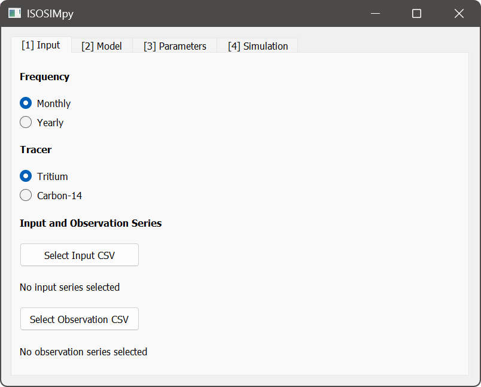
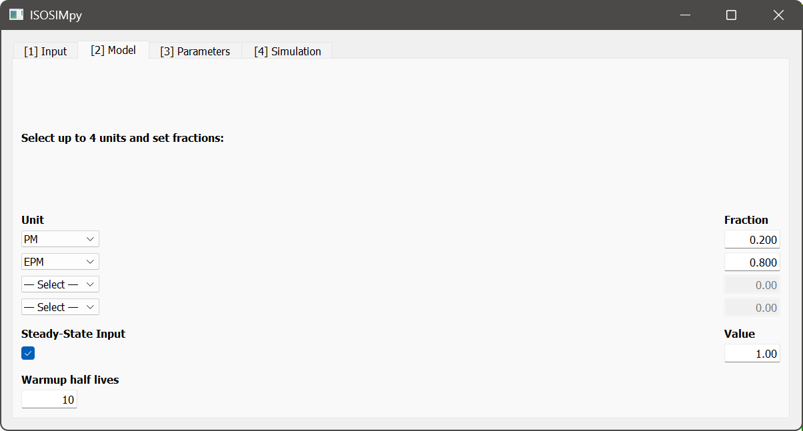
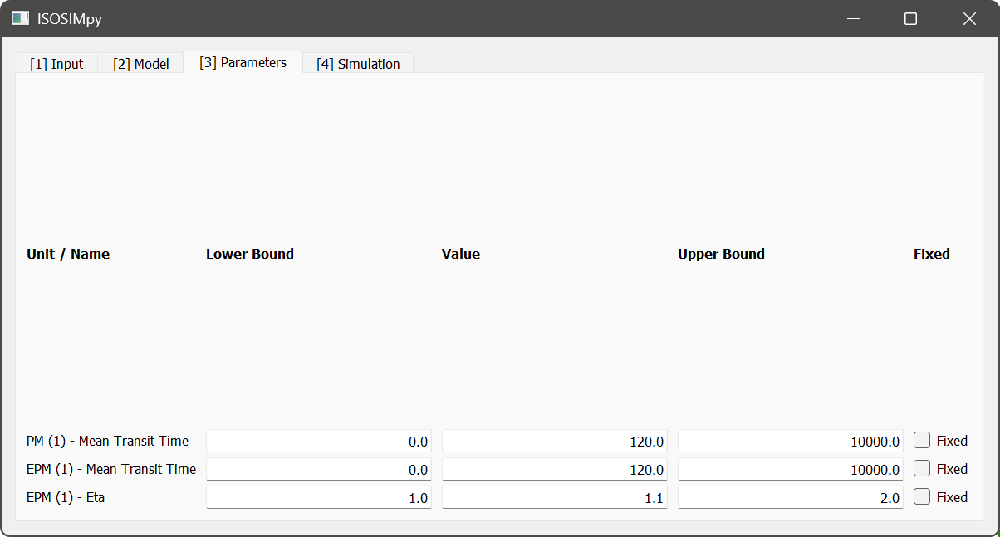
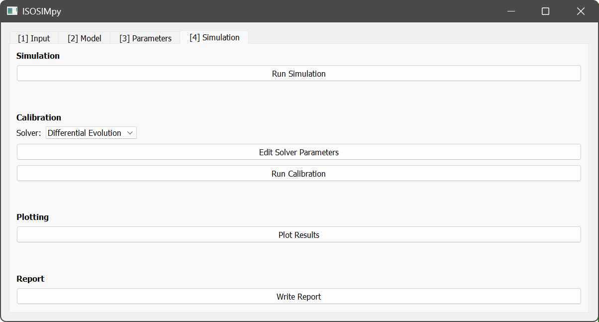
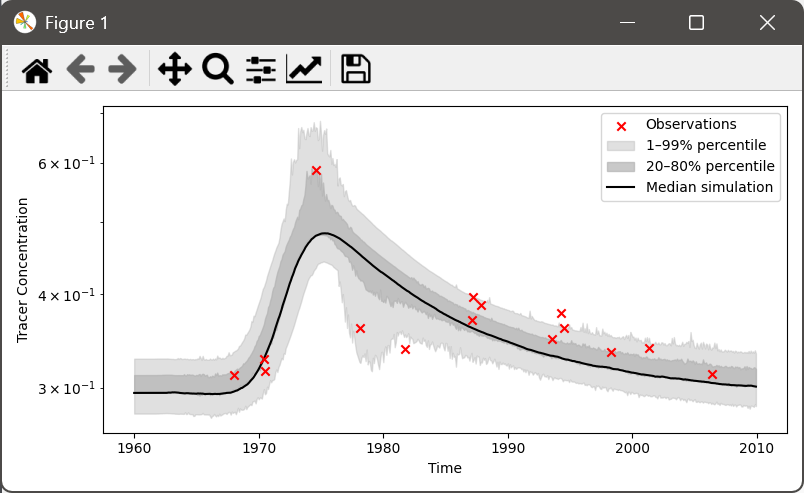
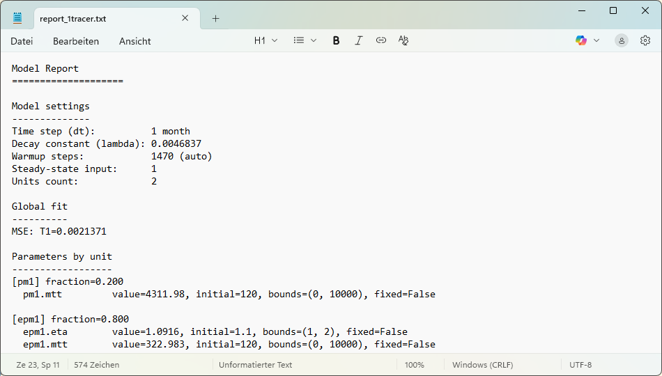

# Verwendung von PyTracerLab

(get-running-de)=
## PyTracerLab auf Ihrem Rechner zum Laufen bringen

Dieser Abschnitt richtet sich an Leserinnen und Leser, die GitHub noch nie verwendet haben und das
Programm einfach nur auf ihrem Rechner haben möchten. Er beschreibt **jeden einzelnen Klick** von der
PyTracerLab-Projektseite bis zum geöffneten PyTracerLab-Fenster. Programmierkenntnisse, eine
Python-Installation oder ein GitHub-Konto sind nicht erforderlich.

```{note}
Die Benutzeroberfläche von GitHub ist standardmäßig englischsprachig. Die Namen der Schaltflächen und
Bereiche werden deshalb im Folgenden **auf Englisch (fett)** angegeben — genau so, wie sie auf dem
Bildschirm erscheinen — jeweils mit einer deutschen Erläuterung.
```

**Was Sie benötigen:**

- einen PC mit **Windows 10 oder Windows 11**
- eine Internetverbindung
- etwa **500 MB freien Speicherplatz** (die Programmdatei selbst ist rund 91 MB groß und entpackt
  sich bei jedem Start vorübergehend selbst)
- ungefähr **5 Minuten**

Sie benötigen **keine** Administratorrechte, und es wird nichts in die Systemordner von Windows
geschrieben.

```{note}
**Dieser Weg funktioniert nur unter Windows.** Wenn Sie macOS oder Linux verwenden oder wenn Ihr
Rechner von einer IT-Abteilung verwaltet wird, die Programme unbekannter Herausgeber blockiert,
folgen Sie stattdessen der Anleitung [Running PyTracerLab Locally](local_installation.md) (auf
Englisch). Dort wird PyTracerLab als Python-Programm installiert, was auf jedem Betriebssystem
funktioniert.
```

### Schritt 1 — Die PyTracerLab-Seite auf GitHub öffnen

Öffnen Sie Ihren Webbrowser und rufen Sie folgende Adresse auf:

<https://github.com/iGW-TU-Dresden/PyTracerLab>

GitHub ist die Website, auf der der Quellcode von PyTracerLab und das fertige Programm abgelegt sind.
Die Seite, auf der Sie landen, wird *Repository* (Projektablage) genannt. Sie benötigen **kein**
GitHub-Konto und müssen sich **nicht** anmelden — alles in dieser Anleitung funktioniert ohne Konto.

In der Mitte der Seite sehen Sie eine Liste von Ordnern und Dateien (`docs`, `src/PyTracerLab`,
`LICENSE` und so weiter). **Diese können Sie vollständig ignorieren.** Was Sie brauchen, befindet sich
auf der rechten Seite.

### Schritt 2 — Den Bereich "Releases" rechts finden

Schauen Sie auf die **rechte Spalte** der Seite. Von oben nach unten enthält sie einen Bereich
**About** (Kurzbeschreibung des Projekts) und darunter einen Bereich mit der Überschrift **Releases**
(Veröffentlichungen). Im folgenden Bild ist er rot umrandet.


Ein *Release* ist eine fertige, verpackte Version des Programms. Der Bereich **Releases** zeigt die
neueste Version, gekennzeichnet mit einer grünen Markierung **Latest** (neueste) — zum Zeitpunkt der
Erstellung dieser Anleitung ist das **v0.2.9**. Die bei Ihnen angezeigte Versionsnummer ist
wahrscheinlich höher; das ist richtig und zu erwarten.


```{tip}
**Sie sehen den Bereich "Releases" nicht?** Wenn Ihr Browserfenster schmal ist, verschiebt GitHub die
gesamte rechte Spalte an das **untere Ende** der Seite. Scrollen Sie entweder ganz nach unten oder
vergrößern Sie das Browserfenster (bzw. klicken Sie auf die Schaltfläche zum Maximieren oben rechts
im Fenster).
```

### Schritt 3 — Die Liste der Releases öffnen

Klicken Sie im Bereich **Releases** auf die Versionsnummer selbst (zum Beispiel **v0.2.9**) oder auf
den blauen Link **+ 19 releases** direkt darunter. Beides führt an dieselbe Stelle: zur Seite mit
allen veröffentlichten Versionen.

### Schritt 4 — Die Download-Dateien finden ("Assets")

Die Seite, auf der Sie sich jetzt befinden, listet alle veröffentlichten Versionen auf, **die neueste
zuerst**. Die neueste Version steht ganz oben und trägt die grüne Markierung **Latest**.

Suchen Sie unterhalb dieser neuesten Version die Überschrift **Assets** mit einer kleinen Zahl
daneben. "Assets" ist die Bezeichnung von GitHub für *die Dateien, die zu dieser Version
heruntergeladen werden können*. Die Liste ist normalerweise bereits aufgeklappt. Sehen Sie
stattdessen nur ein kleines Dreieck **▸ Assets**, klicken Sie einmal auf das Wort **Assets**, um die
Liste aufzuklappen.


### Schritt 5 — Die richtige Datei herunterladen

Die Liste **Assets** enthält fünf Einträge. Nur **einer** davon ist das Programm:

| Datei in der Liste | Was es ist | Brauchen Sie das? |
| --- | --- | --- |
| `pytracerlab-0.2.9-py3-none-any.whl` | Python-Paket | Nein |
| `pytracerlab-0.2.9.tar.gz` | Python-Quellpaket | Nein |
| **`PyTracerLab-v0.2.9.exe`** | **Das fertige Programm** | **Ja — diese hier** |
| `Source code (zip)` | Der Quellcode | Nein |
| `Source code (tar.gz)` | Der Quellcode | Nein |

**Klicken Sie auf die Datei, deren Name auf `.exe` endet** — im Bild oben ist sie rot umrandet. Die
Zahl im Dateinamen ist die Versionsnummer und wird bei neueren Releases höher als `0.2.9` sein;
nehmen Sie immer die `.exe`-Datei, unabhängig von ihrer Versionsnummer.

Die Datei ist etwa **91 MB** groß, der Download dauert daher einen Moment. Ihr Browser zeigt den
Fortschritt an.

### Schritt 6 — Die Download-Warnung des Browsers bestätigen

Ihr Browser wird Sie sehr wahrscheinlich vor dieser Datei warnen, etwa mit Formulierungen wie *"Diese
Datei wird nicht häufig heruntergeladen"* oder *"… wurde blockiert, da sie Ihr Gerät schädigen
könnte"*.

Diese Warnung erscheint, weil die Datei nicht mit einem kostenpflichtigen Signaturzertifikat digital
signiert ist. PyTracerLab ist freie akademische Software und besitzt kein solches Zertifikat. Die
Warnung sagt nichts über den Inhalt der Datei aus — sie erscheint bei jedem heruntergeladenen
Programm ohne ein solches Zertifikat.

So behalten Sie die Datei:

- **Google Chrome** — der Download erscheint in einem kleinen Feld oben rechts im Browser. Fahren Sie
  mit der Maus über den Eintrag, klicken Sie auf die **⋮** (drei Punkte) daneben und wählen Sie
  **Beibehalten** (*Keep*).
- **Microsoft Edge** — an derselben Stelle, oben rechts. Klicken Sie auf die **⋯** (drei Punkte)
  neben dem blockierten Download, wählen Sie **Beibehalten** (*Keep*), dann **Mehr anzeigen**
  (*Show more*) → **Trotzdem beibehalten** (*Keep anyway*).
- **Mozilla Firefox** — klicken Sie auf den Download-Pfeil in der Symbolleiste, klicken Sie mit der
  rechten Maustaste auf den Eintrag und wählen Sie **Download erlauben**.

### Schritt 7 — Die heruntergeladene Datei auf dem Rechner finden

Die Datei liegt jetzt in Ihrem Ordner **Downloads**, normalerweise:

```
C:\Users\<Ihr Windows-Benutzername>\Downloads
```

Öffnen Sie dazu den **Datei-Explorer** (das gelbe Ordnersymbol in der Taskleiste oder die
Tastenkombination `Windows + E`) und klicken Sie in der linken Spalte auf **Downloads**. Gesucht ist
die Datei **`PyTracerLab-v0.2.9.exe`**.

```{important}
**Diese eine Datei *ist* das gesamte Programm.** Es gibt nichts zu installieren. Es wird kein Eintrag
im Startmenü und kein Symbol auf dem Desktop angelegt. Sie können die Datei beliebig verschieben —
zum Beispiel auf den Desktop oder in einen Ordner Ihrer Wahl — und von dort starten. Wenn Sie die
Datei löschen, ist das Programm von Ihrem Rechner verschwunden.
```

### Schritt 8 — Das Programm starten und die Windows-Warnung bestätigen

**Doppelklicken** Sie auf die Datei `PyTracerLab-v0.2.9.exe`.

Windows zeigt daraufhin höchstwahrscheinlich ein blaues Fenster mit dem Titel **"Der Computer wurde
durch Windows geschützt"** (englisch: *"Windows protected your PC"*). Zunächst scheint dieses Fenster
nur eine einzige Schaltfläche anzubieten: **Nicht ausführen** (*Don't run*).

Gehen Sie so vor:

1. Klicken Sie auf den kleinen Link **Weitere Informationen** (*More info*) direkt unter dem
   Meldungstext.
2. Das Fenster klappt auf und zeigt nun den Dateinamen, den Herausgeber — und unten rechts eine neue
   Schaltfläche **Trotzdem ausführen** (*Run anyway*).
3. Klicken Sie auf **Trotzdem ausführen**.

Diese Warnung hat dieselbe Ursache wie die Download-Warnung in Schritt 6: Das Programm ist nicht mit
einem kostenpflichtigen Zertifikat signiert. Sie müssen sie pro heruntergeladener Datei nur einmal
bestätigen.

```{tip}
Sie können die Warnung auch vorab entfernen: Klicken Sie mit der rechten Maustaste auf die Datei,
wählen Sie **Eigenschaften** und setzen Sie unten im Reiter **Allgemein** das Häkchen bei
**Zulassen** bzw. **Blockierung aufheben** (*Unblock*). Bestätigen Sie anschließend mit **OK**.
```

### Schritt 9 — Auf den ersten Start warten

```{warning}
**Für 10 bis 40 Sekunden scheint nichts zu passieren.** Das ist normal.
```

Das Programm ist in eine einzige Datei gepackt und muss sich zunächst in einen temporären Ordner
entpacken, bevor das Fenster erscheinen kann. Beim ersten Start dauert das merklich länger als später.
Währenddessen gibt es weder einen Fortschrittsbalken noch einen Startbildschirm.

**Doppelklicken Sie die Datei in dieser Zeit nicht erneut** — damit starten Sie lediglich eine zweite
Kopie des Programms. Warten Sie, bis das Fenster erscheint. Spätere Starts gehen deutlich schneller.

### Schritt 10 — Das Programm läuft

Das PyTracerLab-Hauptfenster öffnet sich mit dem Eingabe-Tab und sieht so aus:



Das war's — PyTracerLab läuft. Machen Sie weiter mit [Der Eingabe-Tab](#input-tab-de), wo erklärt
wird, was als Nächstes zu tun ist. Wenn Sie eine vollständige Analyse von Anfang bis Ende begleitet
durchführen möchten, lesen Sie
[Verwendung der GUI: ein detailliertes Beispiel](detailed_example_de.md).

### PyTracerLab später erneut starten

Es muss nichts weiter installiert werden. Wann immer Sie PyTracerLab wieder verwenden möchten,
doppelklicken Sie einfach dieselbe `.exe`-Datei. Die Windows-Warnung aus Schritt 8 erscheint für diese
Datei nicht erneut.

### Auf eine neuere Version aktualisieren

PyTracerLab aktualisiert sich **nicht** selbst. Um auf eine neuere Version zu wechseln, wiederholen
Sie die Schritte 1 bis 8 — Sie erhalten dann eine `.exe`-Datei mit einer höheren Versionsnummer. Die
alte Datei können Sie anschließend löschen.

### Wenn etwas nicht funktioniert hat

**Ich habe doppelgeklickt und es passiert nichts.**
Warten Sie eine volle Minute — siehe Schritt 9. Erscheint immer noch kein Fenster, öffnen Sie den
Windows **Task-Manager** (`Strg + Umschalt + Esc`) und prüfen Sie, ob `PyTracerLab` unter *Prozesse*
aufgeführt ist. Sind dort mehrere Kopien gelistet, beenden Sie alle und versuchen es mit einem
einzelnen Doppelklick erneut.

**Das Fenster "Der Computer wurde durch Windows geschützt" hat keine Schaltfläche "Trotzdem ausführen".**
Die Schaltfläche wird erst sichtbar, nachdem Sie auf **Weitere Informationen** geklickt haben — siehe
Schritt 8. Wenn die IT-Richtlinie Ihres Arbeitgebers unsignierte Programme grundsätzlich blockiert,
kann die Schaltfläche ganz fehlen. Verwenden Sie in diesem Fall
[Running PyTracerLab Locally](local_installation.md).

**Die Datei ist nach dem Herunterladen verschwunden.**
Ihre Antivirensoftware hat sie in Quarantäne verschoben. So verpackte Programme lösen häufig
Fehlalarme aus. Stellen Sie die Datei aus der Quarantäneliste Ihres Antivirenprogramms wieder her
oder verwenden Sie [Running PyTracerLab Locally](local_installation.md).

**Das Fenster erscheint kurz und schließt sich sofort wieder.**
Dieser Weg startet das Programm bewusst ohne Konsolenfenster, sodass eine mögliche Fehlermeldung
unsichtbar bleibt. Um zu sehen, was schiefgelaufen ist, installieren Sie PyTracerLab gemäß
[Running PyTracerLab Locally](local_installation.md) als Python-Programm und starten es mit dem Befehl
`PyTracerLab` — diese Variante behält ein Konsolenfenster geöffnet, in dem die Fehlermeldung angezeigt
wird. Bitte melden Sie die Meldung über
[GitHub Issues](https://github.com/iGW-TU-Dresden/PyTracerLab/issues).

**Ich verwende kein Windows.**
Die `.exe`-Datei läuft nur unter Windows. Folgen Sie
[Running PyTracerLab Locally](local_installation.md); diese Anleitung funktioniert auch unter macOS
und Linux.

## Verwendung der grafischen Benutzeroberfläche
Im Allgemeinen ist die Verwendung der grafischen Benutzeroberfläche (GUI) strikter und weniger vielseitig als die Verwendung des zugrunde liegenden Pakets. Konkret setzt die App eine bestimmte Struktur der Zeitreihendaten voraus, lässt sich nicht gut skalieren, um viele unterschiedliche Datensätze zu verarbeiten, und bietet nur begrenzte Nachbearbeitungsfunktionen. Dennoch ist die GUI eine sehr benutzerfreundliche Option, um Analysen von Grundwasserfließzeitverteilungen mit Lumped-Parameter-Modellen durchzuführen.

```{important}
Eingangs- und Beobachtungsdaten werden aus Textdateien (z. B. CSV) mit einer Zeile pro Datum gelesen: Die erste Spalte enthält das Datum, jede weitere Spalte einen Tracer, mit den Spaltennamen in einer Kopfzeile. Tracer-Eingangszeitreihen benötigen regelmäßige monatliche oder jährliche Zeitschritte ohne Lücken; Beobachtungen können nur an ihren Probenahmedaten angegeben werden. Eine ausführliche Beschreibung der Dateistruktur und [Vorlagen](#data-templates-de) finden Sie unter [Vorbereitung der Datensätze](#preparing-datasets-de).
```

(example-datasets-de)=
### Beispieldateien
Die folgenden Beispieldateien können heruntergeladen und direkt in die GUI geladen werden. Sie decken verschiedene Anwendungsfälle hinsichtlich der zeitlichen Auflösung und der Anzahl der Tracer ab. Wählen Sie beim Laden einer Datei auf dem Eingabe-Tab die zeitliche Auflösung und den bzw. die Tracer, die zur Datei passen.

| Eingangsdatei | Beobachtungsdatei | Auflösung | Tracer | Zeitraum | Hinweise |
| --- | --- | --- | --- | --- | --- |
| {download}`example_input_series_1tracer.csv <../examples/example_input_series_1tracer.csv>` | {download}`example_observation_series_1tracer.csv <../examples/example_observation_series_1tracer.csv>` | monatlich | 1 | 1960-01 – 2009-12 | |
| {download}`example_input_series_2tracer.csv <../examples/example_input_series_2tracer.csv>` | {download}`example_observation_series_2tracer.csv <../examples/example_observation_series_2tracer.csv>` | monatlich | 2 (Tritium, Krypton-85) | 1900-01 – 1999-12 | verwendet im [detaillierten Beispiel](detailed_example_de.md) |
| {download}`TracerLPM_benchmark_input_yearly.csv <../examples/TracerLPM_benchmark_input_yearly.csv>` | {download}`TracerLPM_benchmark_observations_yearly.csv <../examples/TracerLPM_benchmark_observations_yearly.csv>` | jährlich | 1 | 1850 – 2020 | TracerLPM-Benchmark |
| {download}`3H_SF6_input.csv <../examples/3H_SF6_input.csv>` | {download}`3H_SF6_observations.csv <../examples/3H_SF6_observations.csv>` | jährlich | 2 (Tritium, SF6) | 1900 – 2020 | SF6 ist nicht in der Tracer-Liste der GUI enthalten; wählen Sie dafür *Stable tracer (no decay)* |
| {download}`input_monthly_modflow.csv <../examples/input_monthly_modflow.csv>` | – | monatlich | 1 | 1970-01 – 2019-12 | keine Beobachtungsdatei; Beobachtungen über *Manual Observation Input* eingeben |
| {download}`benchmark_input_monthly.csv <../examples/benchmark_input_monthly.csv>` | – | monatlich | 1 | 1960-01 – 1969-12 | Impulseingang zur Untersuchung der Modellantwort |
| {download}`benchmark_input_yearly.csv <../examples/benchmark_input_yearly.csv>` | – | jährlich | 1 | 1960 – 1969 | Impulseingang zur Untersuchung der Modellantwort |

### Aufbau der GUI
Die GUI ist in verschiedene **Tabs** gegliedert. Diese **Tabs** repräsentieren den typischen Arbeitsablauf und sollten in ihrer vorliegenden Reihenfolge betrachtet werden. Die einzelnen **Tabs** werden im Folgenden ausführlicher beschrieben.

```{warning}
PyTracerLab befindet sich noch in aktiver Entwicklung. Während die allgemeine Funktionalität gut getestet ist, weist die GUI noch einige Probleme auf, an denen wir aktiv arbeiten.
```

```{warning}
PyTracerLab unterstützt derzeit keinerlei Vorverarbeitungsschritte der Eingangsdaten. Niederschlagsgewichtung, Gasaustausch usw. müssen vom Nutzer vorab durchgeführt werden.
```

```{tip}
Um Probleme bei der Verwendung der GUI zu vermeiden, führen Sie bitte alle Schritte auf allen Tabs in der Reihenfolge durch, in der sie auf dem Tab dargestellt sind. Legen Sie zum Beispiel auf dem Eingabe-Tab zuerst die zeitliche Auflösung fest, dann den bzw. die Tracer, laden Sie anschließend die entsprechenden Eingangsdaten und danach die entsprechenden Beobachtungsdaten.
```

(input-tab-de)=
### 1. Der Eingabe-Tab
In diesem **Tab** werden Datensätze geladen und die grundlegendsten Einstellungen für die anschließende Modellierung vorgenommen.
- Auswahl der zeitlichen Auflösung (jährliche oder monatliche Daten in Zeitreihen und Modellsimulationen)
- Auswahl von einem oder zwei Tracern, die in der Analyse berücksichtigt werden sollen (z. B. $^3\mathrm{H}$, $^{14}\mathrm{C}$, $^{85}\mathrm{Kr}$); ein Tracer pro Spalte der Datendateien, in derselben Reihenfolge
- Auswahl und Laden der Tracer-Eingangszeitreihendatei über den sich öffnenden Dateidialog; ihr Zeitschritt muss zur gewählten zeitlichen Auflösung passen; Details zur Vorbereitung von Tracer-Eingangszeitreihendateien finden Sie [hier](#preparing-datasets-de)
- Auswahl und Laden der Beobachtungsdatei über den sich öffnenden Dateidialog (nach der Eingangszeitreihe); Beobachtungen können für jeden Zeitschritt der Eingangszeitreihe oder nur an den Probenahmedaten angegeben werden; Details zur Vorbereitung von Beobachtungsdateien finden Sie [hier](#preparing-datasets-de)
- kann eine Datei nicht eingelesen werden, nennt eine Meldung die Zeile und den Wert, die das Problem verursacht haben

```{important}
In den Tracer-Eingangsdaten und den Beobachtungsdaten sollten dieselben Einheiten der Tracer-Konzentration verwendet werden. Einheiten werden intern nicht überprüft. **Wenn die Einheiten nicht übereinstimmen, werden unerwünschte und falsche Ergebnisse erzielt!**
```


### 2. Der Modell-Tab
```{warning}
Die Struktur eines Lumped-Parameter-Modells sollte stets auf einem konzeptionellen Verständnis des untersuchten Grundwasserströmungssystems beruhen. Zu diesem Thema gibt es umfangreiche Literatur. Wenn Sie noch nie von Dingen wie „Exponential Model“, „Binary Mixing Model“ oder „Convolution Integral“ gehört haben, sollten Sie sich in diese Themen einlesen, bevor Sie fortfahren. Lumped-Parameter-Modelle sind einfach zu verwenden, aber schwer zu meistern – entsprechende Modellierungsergebnisse sollten stets sorgfältig interpretiert werden, bevor Schlussfolgerungen gezogen werden.
```
In diesem **Tab** werden die verschiedenen Modellteile ausgewählt, die in die Simulationen einbezogen werden.
- Auswahl von bis zu 4 parallel zu verwendenden Modelleinheiten
    - verfügbare Einheiten:
        - Piston-Flow Model (**PM**)
        - Exponential Model (**EM**)
        - Exponential Piston-Flow Model (**EPM**)
        - Dispersion Model (**DM**)
        - Gamma Model (**GM**)
        - Linear Model (**LM**)
        - Partial Exponential Model (**PEM**)
    - die Fließzeitverteilungen und Parameter aller Einheiten sind unter [Modelleinheiten](#model-units-de) beschrieben
    - jede Einheit ist mit einem entsprechenden Anteil der gesamten Systemantwort bzw. -ausgabe verknüpft; die Anteile liegen zwischen 0 und 1 und müssen sich zu eins summieren, andernfalls wird ein Fehler ausgelöst und das Modell läuft nicht
    - bei genau zwei Einheiten (binäre Mischung) wird nur der Anteil der ersten Einheit eingegeben; der Anteil der zweiten Einheit wird als 1 minus diesem Wert berechnet. Der Anteil der ersten Einheit kann kalibriert werden (siehe [Mischungsanteile](#mixing-fractions-de))
- Angabe des stationären Eingangs: die Tracerkonzentration der Grundwasserneubildung vor dem Beginn der Eingangszeitreihe (z. B. natürliches Tritium vor den 1950er-Jahren), ein Wert je Tracer
    - er wird für das gesamte Wasser verwendet, das älter als die Eingangszeitreihe ist (siehe [Eingang vor dem Beginn der Eingangszeitreihe](#steady-state-input-de))
    - ist das Kästchen nicht angekreuzt, wird angenommen, dass Wasser, das vor dem Beginn der Eingangszeitreihe neu gebildet wurde, **keinen Tracer** enthält; der Model-Tab und die Meldung nach jedem Lauf weisen darauf hin

```{important}
Der stationäre Eingangswert wird in denselben Einheiten interpretiert, die in den Tracer-Eingangs- und Beobachtungsdatensätzen verwendet werden. Einheiten werden intern nicht überprüft. **Wenn die Einheiten nicht übereinstimmen, werden unerwünschte und falsche Ergebnisse erzielt!**
```



### 3. Der Parameter-Tab
In diesem **Tab** werden Einstellungen zu den Modellparametern vorgenommen, dazu, wie sie während der Kalibrierung begrenzt werden und welche aktuellen Werte sie annehmen.
- Angabe der unteren Grenze, des aktuellen Werts, der oberen Grenze und des Kalibrierungsstatus für alle Modellparameter; die verschiedenen Modellparameter sind in Zeilen organisiert
    - der für einen Parameter angegebene Wert wird als sein Wert für die einfache Simulation und als Startwert für die Kalibrierung verwendet
    - Parameter, die auf *fixed* gesetzt sind, bleiben während der Kalibrierung auf ihrem angegebenen Wert
    - die Filtergeometrie des PEM (Mächtigkeiten oberhalb des Filters, des Filters und unterhalb des Filters) ist standardmäßig *fixed*, da sie in der Regel aus dem Brunnenausbau bekannt ist (siehe [Modelleinheiten](#model-units-de))
- bei zwei Einheiten enthält eine zusätzliche Zeile *mixing fraction* den Anteil der ersten Einheit: Sein Wert wird im Modell-Tab festgelegt, seine Grenzen und sein Kalibrierungsstatus hier; standardmäßig ist er *fixed* (siehe [Mischungsanteile](#mixing-fractions-de))
    - ein Hinweis erscheint, wenn der Mischungsanteil und die mittleren Fließzeiten beider Einheiten frei sind, da diese Parameter oft stark korreliert sind

```{important}
Zeiteinheiten von Parametern sind stets in Jahren. Halbwertszeiten werden intern umgerechnet, aber andere Parameter mit Zeiteinheiten werden in Monaten interpretiert.
```



(simulation-tab-de)=
### 4. Der Simulations-Tab
In diesem **Tab** können Simulationen durchgeführt, Modellparameter automatisch kalibriert, Ergebnisse geplottet und Berichte erzeugt werden.
- Durchführung einer Modellsimulation mit den aktuellen Parametern
- Durchführung einer Modellkalibrierung
    - Auswahl eines Solvers
    - Änderung der Solver-Parameter (erfordert mindestens ein grundlegendes Verständnis der Solver; siehe [Wahl des Solvers](#choosing-a-solver-de))
    - Festlegen der Messunsicherheit der Beobachtungen (gilt für alle Solver; siehe [Messunsicherheit](#measurement-uncertainty-de)); die aktuelle Einstellung wird unter der Schaltfläche *Edit Solver Parameters* angezeigt
    - Ausführung der automatischen Kalibrierung
- Plotten der Ergebnisse der aktuellen Simulation / der kalibrierten Modellsimulation
- Erstellung eines Berichts einschließlich der kalibrierten Parameter, Fehlermetriken und weiterer Modelldetails in einer Textdatei; verwendet einen Dateidialog zum Speichern der Berichtsdatei

```{tip}
Alle Plots, die PyTracerLab erzeugt, können in der Plot-Ansicht interaktiv angepasst werden. Weitere Details dazu, wie das Erscheinungsbild von Plots geändert werden kann, finden Sie in der (matplotlib-Dokumentation)[https://matplotlib.org/stable/users/explain/figure/interactive.html].
```







(preparing-datasets-de)=
## Vorbereitung der Datensätze
PyTracerLab liest Tracer-Eingangszeitreihen und Beobachtungen aus einfachen Textdateien, zum Beispiel aus CSV-Dateien, die aus einem Tabellenkalkulationsprogramm exportiert wurden. Die GUI und das Python-Paket verwenden dieselbe Einlesefunktion (`read_series`); die folgenden Regeln gelten daher für beide.

(data-templates-de)=
### Vorlagen
Am einfachsten laden Sie die Vorlagen herunter und ersetzen die Beispielwerte durch Ihre eigenen Daten:

- {download}`input_template.csv <../examples/templates/input_template.csv>` – Tracer-Eingangszeitreihe (jährlich, ein Tracer)
- {download}`observations_template.csv <../examples/templates/observations_template.csv>` – Beobachtungen an den Probenahmedaten, mit Messunsicherheiten

Die [Beispieldateien](#example-datasets-de) sind vollständige Datensätze im selben Format.

```{note}
PyTracerLab enthält die Eigenschaften der unterstützten Tracer (z. B. Halbwertszeiten), aber keine Tracer-Eingangszeitreihen. Tracer-Eingangszeitreihen sind aus öffentlichen Quellen erhältlich, für Tritium zum Beispiel aus dem Global Network of Isotopes in Precipitation (GNIP) der IAEA und der WMO (<https://nucleus.iaea.org/wiser>). Jede Aufbereitung der Eingangsdaten (z. B. Niederschlagsgewichtung, Umrechnung von Einheiten) muss vor dem Einlesen in PyTracerLab erfolgen.
```

### Dateistruktur
- **Eine Zeile pro Datum.** Die erste Spalte enthält das Datum, jede weitere Spalte einen Tracer.
- **Kopfzeile:** Eine Zeile mit den Spaltennamen direkt über der ersten Datenzeile ist optional, wird aber empfohlen, z. B. `Date, 3H, SF6`. Sie darf mit `#` beginnen. Zeilen oberhalb der Kopfzeile, die mit `#` beginnen, sind Kommentare.
- **Trennzeichen:** Komma, Semikolon, Tabulator oder Leerzeichen; wird automatisch erkannt. Dateien mit Semikolon, Tabulator oder Leerzeichen als Trennzeichen dürfen ein Dezimalkomma verwenden (`10,5`).
- **Datum:** `YYYY`, `YYYY-MM`, `YYYY-MM-DD` (auch mit `/`), `DD.MM.YYYY`, `MM.YYYY` oder ein Dezimaljahr (z. B. `1985.5`). Eine Uhrzeit nach dem Datum wird ignoriert; eine reine Jahresangabe bezeichnet den 1. Januar dieses Jahres.
- **Fehlende Werte:** leere Zelle, `nan`, `NA`, `n/a` oder `-`.
- **Messunsicherheit (optional):** Eine Spalte mit dem Namen `<Tracer>_sd` (z. B. `3H_sd`) enthält die Messunsicherheit der Spalte `<Tracer>` als Standardabweichung, in derselben Einheit wie der Tracer. Sie wird zur Gewichtung der Beobachtungen bei der Kalibrierung verwendet (siehe [Messunsicherheit](#measurement-uncertainty-de)).
- **Einheiten:** Für einen Tracer muss in der Eingangs- und in der Beobachtungsdatei dieselbe Einheit verwendet werden. Einheiten werden nicht überprüft.
- **Anzahl der Werte:** Es gibt keine feste Obergrenze für die Anzahl der Zeilen oder Beobachtungen.

### Tracer-Eingangszeitreihen
Tracer-Eingangszeitreihen müssen **regelmäßige Zeitschritte ohne Lücken** haben. Die GUI unterstützt monatliche und jährliche Zeitschritte; wählen Sie vor dem Laden der Datei die passende Option unter *Frequency* auf dem [Eingabe-Tab](#input-tab-de). Das Python-Paket akzeptiert jeden regelmäßigen Zeitschritt (z. B. halbjährlich oder täglich). Unregelmäßige Zeitreihen (z. B. einzelne Niederschlagsproben) müssen vorher umgerechnet werden, zum Beispiel auf Monats- oder Jahreswerte.

Eine jährliche Eingangsdatei für zwei Tracer:

```
Date, 3H, SF6
1950, 5.0, 0.0
1951, 5.2, 0.0
...
2020, 5.5, 10.1
```

Dasselbe mit monatlichen Zeitschritten, Semikolons und Dezimalkommas:

```
Date; 3H; SF6
1950-01; 5,0; 0,0
1950-02; 5,1; 0,0
...
2020-12; 5,5; 10,1
```

### Beobachtungen
Beobachtungen beziehen sich immer auf die Zeitschritte der Tracer-Eingangszeitreihe. Sie können auf zwei Arten angegeben werden:

1. **Nur an den Probenahmedaten (empfohlen).** Jede Probe wird dem Zeitschritt der Eingangszeitreihe zugeordnet, der ihr Datum enthält; eine Probe vom 30.09.2009 wird zum Beispiel dem Zeitschritt 2009 einer jährlichen und dem Zeitschritt 2009-09 einer monatlichen Eingangszeitreihe zugeordnet. Zwei Proben desselben Tracers in einem Zeitschritt sind nicht zulässig – fassen Sie diese bitte zu einem Wert zusammen (z. B. ihrem Mittelwert). Alle Probenahmedaten müssen im Zeitraum der Eingangszeitreihe liegen.

   ```
   Date, 3H, 3H_sd, SF6, SF6_sd
   1985-06-12, 52.1, 1.6, ,
   1994-08-03, 18.3, 0.6, 2.4, 0.2
   2004-05-12, 8.9, 0.3, 4.1, 0.3
   ```

2. **Für jeden Zeitschritt der Eingangszeitreihe.** Die Datei enthält dieselben Daten wie die Eingangsdatei, mit einem fehlenden Wert (z. B. `nan`), wo nichts beobachtet wurde. Dies ist das Format der [Beispieldateien](#example-datasets-de).

   ```
   # Date, 3H, SF6
   1950, nan, nan
   1951, nan, nan
   ...
   1985, 52.1, nan
   ...
   2020, nan, nan
   ```

Die Beobachtungsdatei muss dieselben Tracer in derselben Reihenfolge enthalten wie die Eingangsdatei; Zellen von Tracern, die in einer Probe nicht gemessen wurden, bleiben leer. Laden Sie in der GUI die Eingangszeitreihe vor den Beobachtungen. Kann eine Datei nicht eingelesen werden, nennt PyTracerLab die Zeile und den Wert, die das Problem verursacht haben.

### Daten in Python laden
Im Python-Paket werden dieselben Dateien mit `read_series` geladen. Mit `align_to` werden die Beobachtungen wie oben beschrieben den Zeitschritten der Eingangszeitreihe zugeordnet:

```python
import PyTracerLab as lab

inp = lab.read_series("input_template.csv")
obs = lab.read_series("observations_template.csv", align_to=inp)
print(inp.tracers, inp.step)  # ['3H'] 1 year

model = lab.Model(
    dt=1.0,  # ein Zeitschritt = ein Jahr
    lambda_=lab.decay_constant("3H"),  # Zerfallskonstante in 1/Jahr
    input_series=inp.values,
    target_series=obs.values,
)
```

Das Ergebnis von `read_series` enthält die Daten (`times`), die Werte (`values`), die Tracer-Namen aus der Kopfzeile (`tracers`), die Messunsicherheiten aus den `_sd`-Spalten (`uncertainty`) und den Zeitschritt (`step`). Details finden Sie in der {py:func}`API-Dokumentation <PyTracerLab.model.io.read_series>`.

(choosing-a-solver-de)=
## Wahl des Solvers
PyTracerLab bietet vier Solver. Zwei davon suchen die Parameterwerte, mit denen die Beobachtungen am besten wiedergegeben werden (**Kalibrierung**). Die beiden anderen zeigen zusätzlich, wie unsicher die Parameterwerte sind (**Bayes'sche Inferenz** mit Markov-Chain-Monte-Carlo-Verfahren, MCMC).

| Solver | Python-Methode | Ergebnis | Startwerte | Empfohlen für |
|---|---|---|---|---|
| Kleinste Quadrate (Least Squares) | `least_squares` | beste Anpassung in der Nähe der Startwerte | die Anfangswerte der Parameter | schnelle Kalibrierung glatter Probleme; von mehreren Startwerten aus rechnen |
| Differential Evolution | `differential_evolution` | beste Anpassung innerhalb der Grenzen | nicht nötig | Kalibrierung allgemein und immer bei Modellen mit einem PM |
| Metropolis–Hastings (MCMC) | `mcmc_sample` | Stichproben der A-posteriori-Verteilung, eine Kette | die Anfangswerte der Parameter | einfache Probleme, wenn die Schrittweite abgestimmt ist |
| DREAM (MCMC) | `dream_sample` | Stichproben der A-posteriori-Verteilung, mehrere Ketten | nicht nötig | Parameterunsicherheit |

[Paper-Beispiel 2](../examples/paper/paper_example_2.ipynb) vergleicht alle vier Solver an demselben Problem (zwei DM-Einheiten, 241 Zeitschritte, 10 Beobachtungen). Eine Simulation dauerte etwa 0,5 ms, ein Least-Squares-Lauf etwa 0,1 s, Differential Evolution etwa 10 s und Metropolis–Hastings und DREAM jeweils etwa 20 s (32 000 Simulationen).

**Least Squares** ist ein gradientenbasiertes Verfahren: der Trust-Region-Reflective-Algorithmus von SciPy, der mit dem Levenberg-Marquardt-Algorithmus verwandt ist, aber die Parametergrenzen einhält. Er ist mit Abstand der schnellste Solver, findet aber die beste Anpassung *in der Nähe der Anfangswerte*. Wenn mehrere Parameterkombinationen die Beobachtungen einigermaßen gut wiedergeben, kann er bei einer schlechteren stehen bleiben: In Paper-Beispiel 2 erreichten 6 von 10 Läufen mit zufälligen Startwerten die beste Anpassung, 4 blieben bei einer deutlich schlechteren stehen. Rechnen Sie daher von mehreren Startwerten aus (wie in Paper-Beispiel 2) und verwenden Sie das beste Ergebnis. Für die mittlere Fließzeit eines PM ist Least Squares nicht geeignet: Das PM verschiebt das gesamte Wasser um ganze Zeitschritte, die simulierten Werte ändern sich daher in Stufen, und Least Squares kann weit von der besten Anpassung entfernt stehen bleiben.

**Differential Evolution** durchsucht den gesamten Parameterbereich innerhalb der Grenzen mit einer Population von Parametersätzen und benötigt keine Startwerte. Das Verfahren ist langsamer als Least Squares, bleibt aber viel seltener bei einer schlechten Anpassung stehen und eignet sich auch für Modelle mit einem PM. Geben Sie `random_state` an, um reproduzierbare Ergebnisse zu erhalten. Liegt ein kalibrierter Wert an einer seiner Grenzen, erweitern Sie die Grenze, wenn das physikalisch plausibel ist.

**Metropolis–Hastings und DREAM** ziehen Stichproben aus der A-posteriori-Verteilung: den Parameterwerten, die mit den Beobachtungen und ihrer [Messunsicherheit](#measurement-uncertainty-de) vereinbar sind. Die Parametergrenzen wirken dabei als A-priori-Verteilung: Bevor die Beobachtungen berücksichtigt werden, sind alle Werte innerhalb der Grenzen gleich wahrscheinlich. Wählen Sie physikalisch plausible Grenzen; häufen sich die Stichproben an einer Grenze, begrenzt diese Grenze das Ergebnis und nicht die Daten.

- **DREAM** rechnet mehrere Ketten gleichzeitig und bildet seine Vorschläge aus den Differenzen zwischen den Ketten. Dadurch passt es sich selbst an die Größenordnung jedes Parameters und an Korrelationen zwischen Parametern an (Vrugt, 2016). Es ist der empfohlene MCMC-Solver.
- **Metropolis–Hastings** rechnet eine Kette mit einer festen Schrittweite `rw_scale` in den Einheiten der Parameter (in der GUI sind Fließzeiten in Monaten angegeben, in Python in der Zeiteinheit von `dt`). Passt die Schrittweite nicht zu den Parametern, bewegt sich die Kette nur sehr langsam durch den Parameterbereich. Stimmen Sie die Schrittweite so ab, dass etwa 20–30 % der Vorschläge angenommen werden (Vrugt, 2016; Python: `res["accept_rate"]`). Mit nur einer Kette lässt sich R̂ (siehe unten) nicht berechnen; verwenden Sie daher nach Möglichkeit DREAM.

**Konvergenz prüfen.** MCMC-Ergebnisse dürfen erst interpretiert werden, wenn die Ketten konvergiert sind, d. h. wenn sie unabhängig von ihrem Startpunkt dieselbe Verteilung abtasten. Prüfen Sie:

- den **Ketten-Plot**, den die GUI nach einem MCMC- oder DREAM-Lauf anzeigt: Alle Ketten sollten sich im selben Wertebereich bewegen. Eine Kette, die abseits der anderen bleibt, ist nicht konvergiert;
- die **Gelman-Rubin-Statistik R̂** jedes Parameters (Gelman und Rubin, 1992), die die Streuung innerhalb der Ketten mit der Streuung zwischen den Ketten vergleicht. Die GUI zeigt sie im Ketten-Plot von DREAM an („R=…“), in Python ist es `res["gelman_rubin"]`. Das übliche Kriterium für DREAM ist R̂ unter 1,2 für alle Parameter (Vrugt, 2016); je näher an 1, desto besser. Die DREAM-Läufe der [Paper-Beispiele](../examples/index.md) erreichen R̂ ≤ 1,02.

Während des Burn-ins verschiebt DREAM Ketten, die in einem Bereich geringer A-posteriori-Dichte feststecken (z. B. an einem schlechten lokalen Optimum), an die aktuelle Position der besten Kette (Ausreißertest nach Vrugt et al., 2008, bei 10 %, 20 %, …, 90 % des Burn-ins). Die zurückgegebenen Stichproben, die nach dem Burn-in gezogen werden, sind davon nicht betroffen. Die Anzahl der verschobenen Ketten steht in `res["n_outlier_resets"]`; mit `outlier_check=False` wird der Test abgeschaltet. Der Test vergleicht die Ketten miteinander und benötigt daher mindestens 4 Ketten; PyTracerLab warnt, wenn weniger verwendet werden. Die GUI verwendet standardmäßig 8 Ketten, wie die Paper-Beispiele.

**Wenn R̂ zu groß ist:**

- verwenden Sie ein längeres Burn-in und mehr Stichproben, z. B. doppelt so viele;
- verwenden Sie mehr Ketten, z. B. 8 oder doppelt so viele wie freie Parameter;
- sehen Sie sich den Ketten-Plot an: Ketten, die in verschiedenen Bereichen bleiben, deuten auf mehrere Parameterkombinationen hin, die die Beobachtungen etwa gleich gut wiedergeben (z. B. der Mischungsanteil und die mittleren Fließzeiten einer binären Mischung, siehe [Mischungsanteile](#mixing-fractions-de)). Eine solche A-posteriori-Verteilung erfordert längere Läufe oder weniger freie Parameter;
- die Ketten der mittleren Fließzeit eines PM bewegen sich in Stufen von einem Zeitschritt. Eine Kette kann dann lange auf einer benachbarten Stufe bleiben, was R̂ bei kurzen Läufen erhöht ([Tutorial 2](../examples/example_02.ipynb)).

```python
solver = lab.Solver(m)
res = solver.dream_sample(n_samples=4000, burn_in=4000, n_chains=8,
                          sigma_rel=0.05, random_state=42)
print(res["gelman_rubin"])      # R-hat jedes Parameters: sollte unter 1,2 liegen
print(res["n_outlier_resets"])  # während des Burn-ins zur besten Kette verschobene Ketten
```

Literatur: Gelman, A., Rubin, D.B., 1992. Inference from iterative simulation using multiple sequences. Stat. Sci. 7, 457–472 · Vrugt, J.A., ter Braak, C.J.F., Clark, M.P., Hyman, J.M., Robinson, B.A., 2008. Treatment of input uncertainty in hydrologic modeling: Doing hydrology backward with Markov chain Monte Carlo simulation. Water Resour. Res. 44, W00B09 · Vrugt, J.A., 2016. Markov chain Monte Carlo simulation using the DREAM software package: Theory, concepts, and MATLAB implementation. Environ. Model. Softw. 75, 273–316.

(measurement-uncertainty-de)=
## Messunsicherheit
Die Messunsicherheit der Beobachtungen bestimmt, wie stark jede Beobachtung bei der Kalibrierung gewichtet wird: Jedes Residuum (simulierter minus beobachteter Wert) wird durch die Standardabweichung σ der Beobachtung geteilt. Das ist besonders wichtig für Tracer, deren Werte sich über Größenordnungen erstrecken, wie z. B. Tritium. Mit einem einzigen σ für alle Beobachtungen dominieren die Beobachtungen mit den größten Werten (und den größten absoluten Abweichungen) die Kalibrierung.

Die Messunsicherheit kann auf drei Arten angegeben werden:

- **je Beobachtung** in den `_sd`-Spalten der Beobachtungsdatei (siehe [Dateistruktur](#preparing-datasets-de));
- **absolut** als eine Standardabweichung je Tracer, in der Einheit des Tracers;
- **relativ** als Prozentsatz des beobachteten Werts (z. B. 5 %).

Werte aus der Beobachtungsdatei werden verwendet, wo sie angegeben sind; die absolute oder relative Unsicherheit gilt für alle übrigen Beobachtungen. Bleibt eine Beobachtung ohne Unsicherheit, meldet PyTracerLab dies, statt die Beobachtung zu ignorieren.

Die Solver verwenden die Unsicherheit wie folgt:

- **Differential Evolution und Least Squares** minimieren die quadrierten, durch σ geteilten Residuen. Ohne Angabe einer Unsicherheit werden alle Beobachtungen gleich gewichtet.
- **MCMC und DREAM** verwenden eine Gauß'sche Likelihood mit den angegebenen Standardabweichungen, die als bekannt angenommen werden. Ohne Angabe einer Unsicherheit wird die Standardabweichung jedes Tracers als unbekannt behandelt und aus der Likelihood herausintegriert, d. h. sie wird effektiv aus der Abweichung zwischen Simulation und Beobachtungen geschätzt.

```{note}
Die mit MCMC oder DREAM ermittelte Parameterunsicherheit gilt nur unter der Annahme der gewählten Modellstruktur und der angegebenen Messunsicherheit. Beschreibt σ nur die analytische Unsicherheit, während das Modell die Beobachtungen innerhalb dieser Unsicherheit nicht wiedergeben kann, kann die Posterior-Verteilung zu schmal sein.
```

**In der GUI** wird die Messunsicherheit im [Simulations-Tab](#simulation-tab-de) unter *Edit Solver Parameters* → *Measurement uncertainty (all solvers)* festgelegt und gilt für alle Solver. Die aktuelle Einstellung wird unter der Schaltfläche *Edit Solver Parameters* angezeigt. Sind Unsicherheiten angegeben, zeigt der Ergebnis-Plot die Beobachtungen mit Fehlerbalken (± 1 σ).

**In Python** akzeptieren alle Solver-Methoden `sigma` (absolute Standardabweichung: ein Wert, ein Wert je Tracer oder ein Wert je Beobachtung) und `sigma_rel` (relative Standardabweichung als Anteil des beobachteten Werts):

```python
solver = lab.Solver(model)

# Unsicherheiten aus den _sd-Spalten der Beobachtungsdatei
result = solver.dream_sample(n_samples=2000, sigma=obs.uncertainty)

# 5 % des beobachteten Werts
result = solver.dream_sample(n_samples=2000, sigma_rel=0.05)

# aus der Datei, wo angegeben, sonst 5 % des beobachteten Werts
result = solver.dream_sample(n_samples=2000, sigma=obs.uncertainty, sigma_rel=0.05)

# ein absoluter Wert je Tracer (hier: zwei Tracer)
best, sim = solver.differential_evolution(sigma=[1.0, 0.5])
```

Andere Unsicherheitsmodelle können berechnet und als `sigma` übergeben werden, z. B. eine absolute Unsicherheit von 0,3 TU kombiniert mit 5 % des beobachteten Werts: `sigma=np.sqrt(0.3**2 + (0.05 * obs.values) ** 2)`. Details finden Sie in der {py:class}`API-Dokumentation <PyTracerLab.model.solver.Solver>`.

(model-units-de)=
## Modelleinheiten
Jede Einheit beschreibt eine Fließzeitverteilung $g(\tau)$ mit der Fläche eins. Der Parameter `mtt` ($\bar\tau$) ist immer der Mittelwert der Fließzeitverteilung der Einheit; in der GUI wird er in Jahren angegeben. Beim Fließzeitklassen-Modell ist die mittlere Fließzeit kein Parameter, sondern ergibt sich aus den Gewichten der Klassen.

| Einheit | Python-Klasse | Parameter | Fließzeitverteilung | Quelle |
|---|---|---|---|---|
| PM | `PMUnit` | `mtt` | das gesamte Wasser hat die Fließzeit $\bar\tau$; `mtt = 0`: Wasser ohne Verzögerung, das den Tracereingang desselben Zeitschritts enthält (z. B. Oberflächenwasser, das die Probenahmestelle innerhalb eines Zeitschritts erreicht) | Maloszewski und Zuber (1982) |
| EM | `EMUnit` | `mtt` | $g(\tau) = e^{-\tau/\bar\tau}/\bar\tau$ | Maloszewski und Zuber (1982) |
| EPM | `EPMUnit`; GUI: `ExEPMUnit` | `mtt`, `eta`; GUI: `exp_part`, `piston_part` mit $\eta$ = Piston-Anteil / Exponential-Anteil + 1 | exponentielle Verteilung mit der Rate $\eta/\bar\tau$, verschoben um die Piston-Flow-Fließzeit $\bar\tau\,(1 - 1/\eta)$; $\eta = 1$: EM | Maloszewski und Zuber (1982) |
| DM | `DMUnit` | `mtt`, `DP` (Dispersionsparameter) | Lösung der eindimensionalen Advektions-Dispersions-Gleichung | Maloszewski und Zuber (1982) |
| GM | `GMUnit` | `mtt`, `alpha` (Formfaktor $\alpha$) | $g(\tau) = \dfrac{\tau^{\alpha-1}\,e^{-\alpha\tau/\bar\tau}}{(\bar\tau/\alpha)^{\alpha}\,\Gamma(\alpha)}$; $\alpha = 1$: EM; $\alpha < 1$: viele sehr kurze und viele sehr lange Fließzeiten; großes $\alpha$: schmales Maximum um $\bar\tau$ | Amin und Campana (1996); Kirchner et al. (2000) |
| LM | `LMUnit` | `mtt` | gleichverteilt zwischen 0 und $2\bar\tau$ | Maloszewski und Zuber (1982) |
| PEM | `PEMUnit` | `mtt`, `above`, `screen`, `below` | EM, beschränkt auf die Fließzeiten, die ein teilverfilterter Brunnen erfasst (siehe unten) | Jurgens et al. (2012, 2016) |
| Fließzeitklassen (Age bins) | `AgeBinUnit` (nur Python) | `u1` … `u(K-1)` (Koordinaten der Klassengewichte; die Klassengrenzen sind fest) | Histogramm: Fließzeiten innerhalb jeder der $K$ Klassen mit festen Grenzen gleichverteilt, kalibriertes Gewicht je Klasse; keine vorgegebene Form (siehe unten) | Visser et al. (2013); McCallum et al. (2014) |

**Partial Exponential Model (PEM).** Der Grundwasserleiter wird wie beim EM beschrieben (ungespannt, konstante Mächtigkeit, gleichmäßige Grundwasserneubildung, mit der Tiefe zunehmendes Alter), der Brunnen ist jedoch nur über einen Teil der wassererfüllten Mächtigkeit verfiltert. Die Geometrie wird durch drei Mächtigkeiten in einer beliebigen gemeinsamen Längeneinheit angegeben (nur ihre Verhältnisse sind von Bedeutung):

- `above`: nicht erfasste Mächtigkeit oberhalb des Filters, d. h. Tiefe der Filteroberkante unter dem Grundwasserspiegel,
- `screen`: Filterlänge (erfasste Mächtigkeit),
- `below`: nicht erfasste Mächtigkeit unterhalb des Filters, d. h. Abstand von der Filterunterkante bis zur Basis des Grundwasserleiters.

Wie in TracerLPM ist `mtt` die mittlere Fließzeit des **erfassten** Wassers; die mittlere Fließzeit des gesamten Grundwasserleiters ergibt sich daraus (Python: `PEMUnit.mtt_aquifer`). Mit `above = below = 0` ist das PEM das EM. Mit `below = 0` (Filter reicht bis zur Basis des Grundwasserleiters) ist es das PEM von TracerLPM mit „PEM ratio“ = `above / screen`, das dieselbe Fließzeitverteilung ergibt wie das EPM mit $\eta = 1 + \ln(1 + \mathrm{above}/\mathrm{screen})$ (Jurgens et al., 2012). Die Geometrieparameter sind standardmäßig *fixed*, sowohl in der GUI als auch in Python.

```python
pem = lab.PEMUnit(mtt=20.0, above=12.0, screen=30.0, below=8.0)  # Mächtigkeiten in m
m.add_unit(pem, fraction=1.0, prefix="pem",
           bounds=[(1.0, 200.0), (0.0, 100.0), (0.1, 100.0), (0.0, 100.0)])
# nur pem.mtt wird kalibriert; eine Mächtigkeit freigeben mit m.set_fixed("pem.below", False)
print(pem.mtt_aquifer)  # mittlere Fließzeit des gesamten Grundwasserleiters
```

**Fließzeitklassen-Modell (formfreie Fließzeitverteilung).** Statt eine Form vorzugeben, wird die Fließzeitverteilung als Histogramm beschrieben: Sie wählen $K$ Klassen mit festen Grenzen $0 \le a_0 < a_1 < \dots < a_K$, und der Anteil des Wassers in jeder Klasse (Klassengewichte $w_k \ge 0$ mit $\sum_k w_k = 1$) wird kalibriert; innerhalb einer Klasse sind die Fließzeiten gleichverteilt (Visser et al., 2013; McCallum et al., 2014). Die mittlere Fließzeit, $\sum_k w_k\,(a_{k-1} + a_k)/2$, ergibt sich aus den Gewichten. Da sich die Gewichte zu eins summieren müssen, wird die Einheit durch $K-1$ Koordinaten `u1`, …, `u(K-1)` zwischen 0 und 1 beschrieben, die durch „Stick-Breaking“ in die Gewichte umgerechnet werden. Jede Kombination von Koordinaten ergibt ein gültiges Histogramm, sodass alle Solver verwendet werden können, und die voreingestellte gleichförmige Prior-Verteilung von MCMC und DREAM gibt jedem Histogramm dieselbe Prior-Wahrscheinlichkeit. Bei zwei Klassen ist `u1` das Gewicht der ersten Klasse.

- Klassen dürfen über den Beginn der Eingangszeitreihe hinausreichen, z. B. eine breite letzte Klasse (60–1000 Jahre) für altes Wasser; wie bei allen Einheiten hat Wasser, das älter als die Eingangszeitreihe ist, die Konzentration des [stationären Eingangs](#steady-state-input-de). Alternativ kann altes Wasser durch eine zweite Einheit (z. B. ein PM) mit einem [Mischungsanteil](#mixing-fractions-de) dargestellt werden.
- Tracerdaten bestimmen meist nur einige Eigenschaften der Fließzeitverteilung, etwa die mittlere Fließzeit und den Anteil jungen Wassers, nicht aber ihre vollständige Form (McCallum et al., 2014). Verwenden Sie wenige Klassen (z. B. 3–6) und MCMC oder DREAM, um zu sehen, welche Gewichte durch die Daten bestimmt sind; PyTracerLab warnt, wenn es mehr freie Parameter als Beobachtungen gibt. Es wird keine Glättungsbedingung (Regularisierung) verwendet.
- Das Fließzeitklassen-Modell ist nur in Python verfügbar.

```python
bins = lab.AgeBinUnit(edges=[0, 10, 20, 40, 60, 1000])  # Jahre; gleiche Anfangsgewichte
m = lab.Model(dt=1.0, lambda_=lab.decay_constant("Tritium"),
              input_series=inp.values, target_series=obs.values,
              steady_state_input=5.0)  # Tritium vor der Eingangszeitreihe
m.add_unit(bins, fraction=1.0, prefix="bins")  # Grenzen (0, 1) der Koordinaten werden gesetzt
res = lab.Solver(m).dream_sample(n_samples=2000, sigma_rel=0.1)
w = bins.weights_from_samples(res, "bins")  # Klassengewichte jeder Stichprobe, Form (n, K)
mtt = w @ bins.centres                      # mittlere Fließzeit jeder Stichprobe
young = w[:, :2].sum(axis=1)                # Anteil des Wassers jünger als 20 Jahre
print(bins.weights, bins.cumulative, bins.mtt)  # aktueller Zustand der Einheit
```

**Zeitliche Diskretisierung.** Beim EPM, GM, LM, PEM und Fließzeitklassen-Modell erhält jeder Zeitschritt das exakte Integral der Fließzeitverteilung (einschließlich Zerfall) über den Zeitschritt, wie in TracerLPM. Dadurch bleiben die Ergebnisse auch mit jährlichen Zeitschritten genau, und die simulierten Werte ändern sich stetig mit den Parametern. EM und DM werten die Fließzeitverteilung an den Zeitschritten aus (Trapezregel); das PM ordnet das gesamte Wasser dem Zeitschritt zu, der `mtt` am nächsten liegt (bei `mtt = 0` dem aktuellen Zeitschritt). Die simulierten Werte eines PM ändern sich daher in Stufen von einem Zeitschritt, wenn sich `mtt` ändert (siehe [Wahl des Solvers](#choosing-a-solver-de)).

Literatur: Amin, I.E., Campana, M.E., 1996. A general lumped parameter model for the interpretation of tracer data and transit time calculation in hydrologic systems. J. Hydrol. 179, 1–21 · Jurgens, B.C., Böhlke, J.K., Eberts, S.M., 2012. TracerLPM (Version 1): An Excel® workbook for interpreting groundwater age distributions from environmental tracer data. U.S. Geological Survey Techniques and Methods 4-F3 · Jurgens, B.C., Böhlke, J.K., Kauffman, L.J., Belitz, K., Esser, B.K., 2016. A partial exponential lumped parameter model to evaluate groundwater age distributions and nitrate trends in long-screened wells. J. Hydrol. 543, 109–126 · Kirchner, J.W., Feng, X., Neal, C., 2000. Fractal stream chemistry and its implications for contaminant transport in catchments. Nature 403, 524–527 · Maloszewski, P., Zuber, A., 1982. Determining the turnover time of groundwater systems with the aid of environmental tracers. 1. Models and their applicability. J. Hydrol. 57, 207–231 · McCallum, J.L., Engdahl, N.B., Ginn, T.R., Cook, P.G., 2014. Nonparametric estimation of groundwater residence time distributions: What can environmental tracer data tell us about groundwater residence time? Water Resour. Res. 50, 2022–2038 · Visser, A., Broers, H.P., Purtschert, R., Sültenfuß, J., de Jonge, M., 2013. Groundwater age distributions at a public drinking water supply well field derived from multiple age tracers (⁸⁵Kr, ³H/³He, and ³⁹Ar). Water Resour. Res. 49, 7778–7796.

(mixing-fractions-de)=
## Mischungsanteile
In einer binären Mischung (zwei parallele Einheiten) kann der Anteil der ersten Einheit, $f$, zusammen mit den übrigen Parametern kalibriert werden; die zweite Einheit trägt $1 - f$ bei. Wie jeder andere Parameter hat der Anteil Grenzen (zwischen 0 und 1) und ist standardmäßig *fixed*, sodass er nur kalibriert wird, wenn dies ausdrücklich gewählt wird. Bei drei oder vier Einheiten sind die Anteile feste Modelleigenschaften; verschiedene Anteile können dann in Szenarien verglichen werden.

Ob der Mischungsanteil und die mittleren Fließzeiten beider Einheiten gemeinsam bestimmt werden können, hängt von der verfügbaren Information ab:

- Die Anzahl unabhängiger Beobachtungen darf nicht kleiner sein als die Anzahl freier Parameter. Für eine einzelne Probe bedeutet das mindestens so viele Tracer wie freie Parameter; PyTracerLab gibt eine Warnung aus, wenn es mehr freie Parameter als Beobachtungen gibt.
- Die Tracer müssen sich ergänzende Information enthalten. Tracer mit gegensätzlichem Eintragsverlauf (z. B. Tritium und SF₆) bestimmen eine binäre Mischung deutlich besser als Tracer mit ähnlichem Verlauf (z. B. Tritium und tritiogenes Helium); eine lange Zeitreihe von Beobachtungen enthält zudem mehr Information als eine einzelne Probe.
- Ist die Information begrenzt, sollte die mittlere Fließzeit einer Einheit festgelegt werden (z. B. einer „alten“, tracerfreien Komponente), und der Anteil sowie die mittlere Fließzeit der anderen Einheit werden kalibriert (vgl. Jurgens et al., 2012).

Mit MCMC oder DREAM zeigt sich eine schlecht bestimmte Mischung als starke Korrelation zwischen dem Anteil und den mittleren Fließzeiten in den Posterior-Stichproben; Differential Evolution und Least Squares liefern dann nur eine von vielen gleich guten Lösungen.

**In Python** ist der Mischungsanteil der Parameter `"<Präfix der ersten Einheit>.fraction"`:

```python
m.add_unit(lab.EPMUnit(mtt=10.0, eta=1.5), fraction=0.6, prefix="young",
           bounds=[(1.0, 100.0), (1.0, 3.0)])
m.add_unit(lab.PMUnit(mtt=500.0), fraction=0.4, prefix="old", bounds=[(100.0, 1000.0)])
m.set_fixed("old.mtt")                      # mittlere Fließzeit einer Einheit festlegen
m.set_fixed("young.fraction", False)        # Mischungsanteil kalibrieren
m.set_bounds("young.fraction", (0.2, 0.8))  # optional, Standard (0, 1)
```

(steady-state-input-de)=
## Eingang vor dem Beginn der Eingangszeitreihe
Heute beprobtes Grundwasser kann älter sein als die Tracer-Eingangszeitreihe. Für dieses Wasser verwendet PyTracerLab den **stationären Eingang**: die Tracerkonzentration der Grundwasserneubildung vor dem Beginn der Eingangszeitreihe, die als zeitlich konstant angenommen wird (z. B. die natürliche Tritiumkonzentration des Niederschlags vor den 1950er-Jahren). Der radioaktive Zerfall während der Fließzeit wird wie für alles andere Wasser berücksichtigt.

Der Beitrag dieses Wassers wird exakt aus der Fließzeitverteilung berechnet: In jedem Zeitschritt ist er der stationäre Eingang multipliziert mit dem (zerfallskorrigierten) Anteil des Wassers, das älter ist als die seit dem Beginn der Eingangszeitreihe vergangene Zeit. Es muss daher keine Warmlaufzeit gewählt werden, es gibt keine Begrenzung der Fließzeiten oder Halbwertszeiten (z. B. ¹⁴C oder sehr altes Wasser), und die Fließzeitverteilungen werden am Beginn der Eingangszeitreihe nicht abgeschnitten.

**Ohne stationären Eingang** wird angenommen, dass Wasser, das vor dem Beginn der Eingangszeitreihe neu gebildet wurde, **keinen Tracer** enthält. Das trifft für Tracer zu, die es vorher nicht gab (z. B. SF₆, FCKW, ⁸⁵Kr, sofern die Eingangszeitreihe früh genug beginnt), nicht aber für Tritium oder ¹⁴C. Da dies leicht übersehen wird, zeigt PyTracerLab einen Hinweis:

- in der GUI unter dem Kästchen für den stationären Eingang im Model-Tab und in der Meldung nach einer Simulation oder Kalibrierung;
- in Python als Warnung bei der ersten Simulation eines Modells. Um zu bestätigen, dass das Wasser vor der Eingangszeitreihe tracerfrei ist, geben Sie `steady_state_input=0` an; dann erscheint die Warnung nicht mehr.

```python
m = lab.Model(dt=1.0, lambda_=lab.decay_constant("Tritium"),
              input_series=inp.values, target_series=obs.values,
              steady_state_input=5.0)  # TU vor dem Beginn der Eingangszeitreihe
```

Bei zwei Tracern geben Sie einen Wert je Tracer an (z. B. `steady_state_input=[5.0, 0.0]` für Tritium und SF₆). Für tritiogenes ³He geben Sie den stationären Tritium-Eingang an. Die Argumente `n_warmup_half_lives` und `n_warmup_steps` früherer Versionen werden weiterhin akzeptiert, haben aber keine Wirkung.
